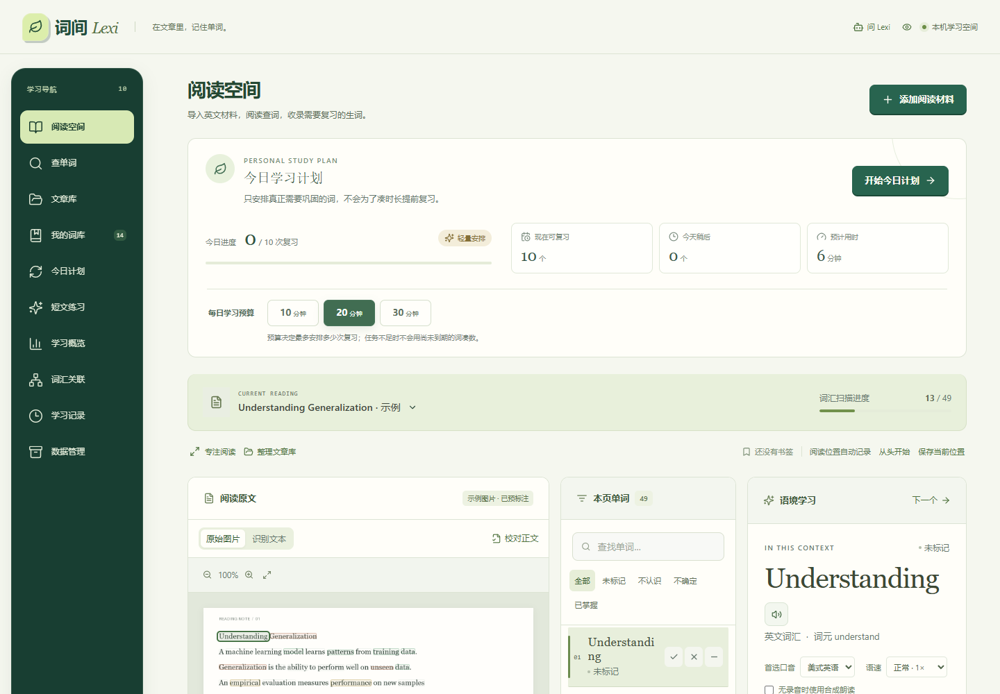
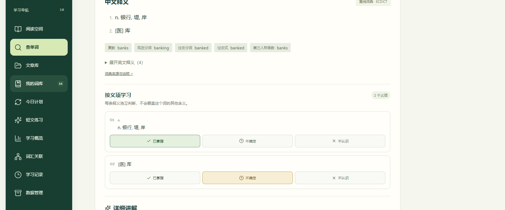
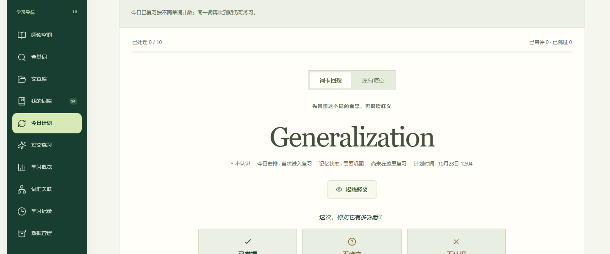
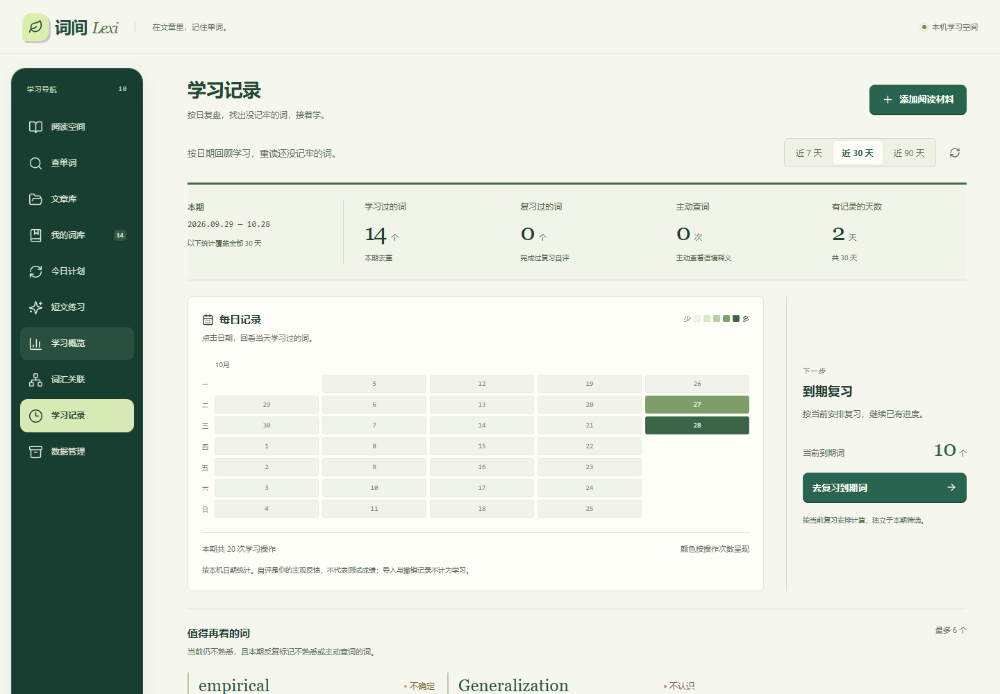
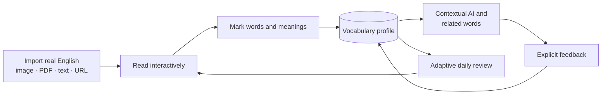

<p align="center">
  
</p>

<h1 align="center">Lexi · 词间</h1>

<p align="center"><strong>Read real English. Build a vocabulary profile from every interaction.</strong></p>

<p align="center">
  Lexi turns images, PDFs, web articles, and pasted text into an interactive reading workspace.<br>
  Learn words in context, call AI only when it helps, and let your history shape what to review next.
</p>

<p align="center">
  <a href="README.md">简体中文</a> · <strong>English</strong>
</p>

<p align="center">
  <a href="https://github.com/MuAn1228/lexi-read/actions/workflows/backend.yml"></a>
  <a href="https://github.com/MuAn1228/lexi-read/actions/workflows/container.yml"></a>
  
  
</p>



> [!NOTE]
> The product UI is currently primarily in Simplified Chinese. There is no hosted demo yet; the local setup below is the fastest way to try Lexi.

## What is Lexi?

Lexi is a local-first, AI-assisted English reading and vocabulary learning workspace. Instead of separating reading, dictionary lookup, and flashcards into unrelated tasks, it keeps them in one learning loop:

**Reading → word interaction → vocabulary profile → contextual AI → feedback → adaptive review**

OCR is only the entry point. The useful part begins after the text becomes interactive: Lexi remembers which words and meanings you know, keeps their original context, learns from explicit feedback, and uses that record to organize later review.

## Why Lexi?

| Reading first | Context stays attached | Feedback compounds |
| --- | --- | --- |
| Start from material you actually want to read—not a predefined word list. | A word remains connected to its sentence, article, source, and exact occurrence. | Status changes, lookups, recommendation feedback, and review results build a persistent vocabulary profile. |

AI is optional and on demand. Core importing, OCR, dictionary lookup, marking, history, and review work without an LLM API key. When configured, the model receives bounded reading context and relevant learning summaries to explain the current word or sentence—not just a bare dictionary headword.

## Highlights

- **Interactive reading from real material** — import JPG/PNG images, text or scanned PDFs, pasted English, or public article URLs. PaddleOCR runs locally for image-based content.
- **Word- and sense-level learning** — mark a word as known, unknown, or uncertain, then track individual dictionary meanings independently when one word has several senses.
- **A practical dictionary workspace** — search without opening an article; view bundled Chinese definitions, phonetics, inflections, spelling suggestions, pronunciation, and cached detailed explanations.
- **Portable article word lists** — merge unassessed article words into headwords in first-appearance order, then export a textbook-style two-column list with phonetics and full Chinese definitions as TXT or A5/PDF.
- **Context-aware AI tools** — request word explanations, sentence analysis, article Q&A, a study companion, or personalized short reading practice through a replaceable OpenAI-compatible provider.
- **Personalized word discovery** — related-word suggestions combine context, vocabulary status, learning value, and prior useful/not-useful feedback, with a deliberately small result set.
- **Adaptive daily review** — choose a 10, 20, or 30 minute plan; due words are prioritized using explicit review history, recent difficulty, response time, reading frequency, and rule-based mastery signals.
- **Learning records that lead somewhere** — dashboards and history views surface vocabulary composition, recurring difficult words, activity patterns, and items worth revisiting.
- **Durable local data** — SQLite persistence, article management, OCR proofreading, reading-position recovery, automatic recovery points, and full backup/restore are built in.

## Product tour

### Look up and learn by meaning

Local definitions, detailed explanations, independent sense states, and Lexi's in-context study companion stay in one complete workspace.



### Review what is due

See the whole daily plan, recall before revealing the answer, then update the next interval with an explicit self-rating.



### Turn history into a next step

Inspect learning activity, due reviews, and the words that still need attention.



All screenshots use isolated demo data. No personal vocabulary, reading material, or API credentials are included.

## How it works



1. Import a screenshot, PDF, article, or public webpage.
2. Lexi preserves readable text, word positions, sentences, and source context.
3. Select words while reading and mark what you know.
4. Build a persistent profile at both whole-word and dictionary-sense level.
5. Ask for contextual explanations or discover a few related words when useful.
6. Review due items, then use the dashboard and history to choose what to revisit.

## Quick start

### Requirements

- Python 3.12
- Node.js 22.12 or newer
- Git
- Windows is the most thoroughly exercised local path. Linux is also covered by CI and the container OCR smoke test.

### Windows

```powershell
git clone https://github.com/MuAn1228/lexi-read.git
cd lexi-read

py -3.12 -m venv .venv
.\.venv\Scripts\python.exe -m pip install -r requirements.txt -r requirements-ocr.txt
Copy-Item .env.example .env

powershell.exe -NoProfile -ExecutionPolicy Bypass -File .\open.ps1
```

`open.ps1` builds the frontend when needed, starts FastAPI in the background, and opens [http://127.0.0.1:8000](http://127.0.0.1:8000). Stop it with `stop.ps1` or `关闭词间.cmd`.

The first OCR request downloads Paddle models. SQLite requires no separate installation.

<details>
<summary><strong>Linux / macOS shell</strong></summary>

```bash
git clone https://github.com/MuAn1228/lexi-read.git
cd lexi-read

python3.12 -m venv .venv
source .venv/bin/activate
python -m pip install -r requirements.txt -r requirements-ocr.txt
cp .env.example .env

npm --prefix frontend ci
npm --prefix frontend run build
python -m uvicorn backend.main:app --host 127.0.0.1 --port 8000
```

Paddle wheel availability varies by operating system and architecture. The Linux CI path uses an amd64 Debian-based container; macOS OCR setup may require platform-specific Paddle instructions.

</details>

Without an LLM key, Lexi starts in clearly labeled offline mode. Reading, local OCR, the bundled dictionary, vocabulary marking, history, and review remain available; generative features are limited.

## Configure an AI provider

Lexi uses an OpenAI-compatible Chat Completions adapter. Copy `.env.example` to `.env`, then set your provider values on the backend:

```dotenv
LLM_PROVIDER=openai_compatible
LLM_BASE_URL=https://your-provider.example/v1
LLM_MODEL=your-model-name
LLM_API_KEY=your-secret-key
LLM_JSON_MODE=true
```

If the provider does not document `response_format`, set `LLM_JSON_MODE=false`; Lexi still validates the returned structure. The repository includes a commented Agnes 3.0 Flash preset in `.env.example`.

Check the connection before opening the app:

```powershell
.\.venv\Scripts\python.exe scripts\check_llm.py
```

Never place an API key in a `VITE_*` variable or commit `.env`.

## Architecture

| Layer | Responsibility | Main technology |
| --- | --- | --- |
| Web client | Reading, word interaction, review, history, data management | React 19, TypeScript 5.9, Vite |
| API | Validation, ownership, import flows, learning transactions | FastAPI, Pydantic, Uvicorn |
| Learning data | Documents, occurrences, word/sense state, events, schedules, feedback | SQLAlchemy, SQLite |
| OCR and extraction | Images, scanned/mixed PDFs, public web articles | PaddleOCR, pypdf, pypdfium2, Trafilatura |
| AI adapter | Context explanations, Q&A, practice, related words | HTTPX, OpenAI-compatible Chat Completions, strict response validation |
| Optional speech | Dictionary recordings and local sentence/word synthesis | Wikimedia sources, Piper, Kitten Micro |

The frontend talks only to the FastAPI backend. API keys remain server-side. Learning updates preserve event history transactionally, and retry-sensitive flows use persistent receipts.

## Local-first, not offline-only

- In the default `local` mode, documents and learning data live in a local SQLite database, and PaddleOCR runs on the device.
- AI features are explicit actions. They send the selected word, sentence, bounded article context, and a relevant learning summary to the provider you configure.
- Web import fetches the submitted public URL. Optional Maimemo sync, Wikimedia dictionary audio, model downloads, and configured AI providers also require network access.
- Full backups include learning data and source files, but exclude API keys, logs, generated caches, and downloadable model files.
- Public mode isolates browser guest spaces, but it is not an account system and does not provide cross-device recovery.

## Deployment

There is currently **no public demo**. GitHub Pages can host only the React frontend; FastAPI, PaddleOCR, SQLite, and LLM calls require a separate HTTPS backend.

- [Pages and backend deployment notes](docs/DEPLOYMENT.md)
- [Single-server Docker Compose + Caddy template](deploy/vps/README.md)

The current Docker path is API-only and targets a single-worker SQLite deployment. It does not yet package the frontend or the bundled offline ECDICT asset, so treat it as deployment scaffolding rather than a one-command feature-parity release.

## Current limitations

- The product interface is mainly Simplified Chinese; English UI localization is not complete.
- OCR quality depends on the source. Handwriting, skewed images, complex columns, tables, and low-resolution scans may need proofreading.
- The rule-based mastery score and adaptive queue are product heuristics, not a validated memory-probability model.
- Local mode is designed for one user. Public guest mode has no login, synchronization, or multi-instance database architecture.
- Static or publicly readable web articles work best; login walls, paywalls, CAPTCHAs, and heavily client-rendered pages are not supported.
- A project-wide license has not yet been declared. See [License](#license) before reusing the code.

## Engineering status

This is a working, evolving MVP rather than a production SaaS. The repository includes:

- backend regression tests and frontend behavior tests;
- a Linux container job that runs a real PaddleOCR smoke test;
- migration-time backups, retry-safe writes, integrity-checked full backup/restore;
- browser and responsive verification records for major feature stages.

See [VERIFICATION.md](VERIFICATION.md) for the detailed verification log. Focused design notes include [adaptive review](docs/ADAPTIVE_REVIEW_V2.md), [AI waiting and cancellation](docs/AI_WAITING.md), [the study companion](docs/AI_COMPANION.md), and [word annotations](docs/WORD_ANNOTATIONS.md).

## Roadmap

Planned or being explored—not shipped promises:

- choose and publish a project-level license and contributor guide;
- localize the product interface beyond Simplified Chinese;
- add proper accounts and cross-device synchronization;
- improve OCR reading order and complex-layout handling;
- experiment with embeddings or reranking for vocabulary discovery;
- publish a hosted demo after a sustainable backend is available.

## Contributing

Bug reports, setup feedback, and focused design discussions are useful now. Please open an issue before preparing a large pull request; the project-level license and formal contribution policy are still pending.

## License

No project-wide license has been declared yet. The source is publicly visible, but permission to reuse, redistribute, or create derivative works has **not** been granted unless a file states otherwise. Third-party dictionaries, icons, speech models, and recordings retain their own terms under [`docs/third-party`](docs/third-party/).

---

If Lexi's reading-first approach is useful to you—or you are exploring the intersection of AI and vocabulary learning—a Star is a simple way to follow its progress.
