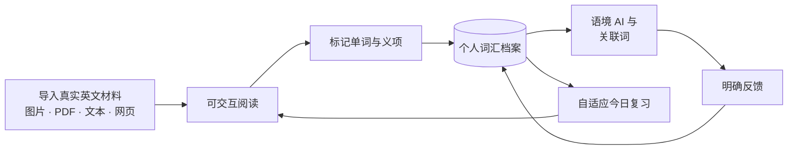

<p align="center">
  
</p>

<h1 align="center">词间 Lexi</h1>

<p align="center"><strong>读真实的英文，让每一次交互都沉淀为自己的词汇档案。</strong></p>

<p align="center">
  词间把图片、PDF、网页文章和粘贴文本变成可交互的英语阅读空间。<br>
  在语境中学词，需要时再调用 AI，并让学习历史决定接下来复习什么。
</p>

<p align="center">
  <strong>简体中文</strong> · <a href="README.en.md">English</a>
</p>

<p align="center">
  <a href="https://github.com/MuAn1228/lexi-read/actions/workflows/backend.yml"></a>
  <a href="https://github.com/MuAn1228/lexi-read/actions/workflows/container.yml"></a>
  
  
</p>


> [!NOTE]
> 当前产品界面以简体中文为主，尚无可公开访问的在线 Demo；按下方步骤在本地运行是最快的体验方式。

## 词间是什么？

词间是一个本地优先、由 AI 辅助的英语阅读与词汇学习工作台。它不把阅读、查词和背词拆成互不相干的任务，而是把它们连接成一个持续积累的学习闭环：

**阅读 → 单词交互 → 个人词汇档案 → 语境 AI → 反馈 → 自适应复习**

OCR 只是入口。真正有价值的部分从文字变得可交互之后开始：词间会记住你认识哪些词和具体义项，保留它们的原始语境，从明确反馈中更新记录，再据此安排后续复习。

## 为什么是词间？

| 从阅读出发 | 语境不会丢失 | 反馈会持续积累 |
| --- | --- | --- |
| 从你真正想读的材料开始，而不是先接受一份固定词表。 | 单词始终可以回到原句、文章、来源和具体出现位置。 | 掌握状态、主动查词、推荐反馈和复习结果会形成持久的个人词汇档案。 |

AI 是可选且按需触发的。没有 LLM API Key 时，材料导入、本地 OCR、本地词典、词汇标记、历史和复习仍然可以使用。配置模型后，词间会结合有限的阅读上下文与相关学习摘要解释当前单词或句子，而不是只把一个孤立的词头发给模型。

## 核心能力

- **把真实材料变成可交互阅读** —— 支持 JPG/PNG 图片、文字或扫描 PDF、粘贴英文和公开网页链接；图片材料由本机 PaddleOCR 识别。
- **整词与义项分开学习** —— 可以标记“已掌握 / 不认识 / 不确定”，也可以在一词多义时分别记录每个词典释义项的状态和复习进度。
- **可独立使用的查词工作台** —— 无需先打开文章即可查词，查看内置中文释义、音标、词形、拼写建议、发音和已经缓存的详细讲解。
- **可随身携带的文章生词表** —— 将当前文章中尚未完成词库标注的词按首次出现顺序归并为原形，生成带音标和完整中文释义的教材式双栏词表，可下载 TXT 或打印为 A5 / PDF。
- **结合上下文的 AI 工具** —— 通过可替换的 OpenAI-compatible 服务，主动请求单词讲解、句子解析、文章问答、学习助手或个性化短文。
- **个性化关联词发现** —— 推荐会结合文章语境、当前词汇状态、学习价值和以往“有用 / 没用”反馈，并刻意控制结果数量。
- **自适应今日复习** —— 可选择 10、20 或 30 分钟计划；真正到期的词会根据明确复习历史、近期困难、作答耗时、阅读频率和规则掌握度排序。
- **能帮助决策的学习记录** —— 学习概览和历史页会展示词库构成、反复困难的词、活动节奏及值得重新关注的内容。
- **可靠的本地数据链路** —— 使用 SQLite 持久化，并提供文章库、OCR 校对、阅读续接、自动恢复点以及完整备份与恢复。

## 产品预览

### 按含义查词和学习

本地释义、详细讲解、互不覆盖的义项状态，以及 Lexi 的语境学习助手，都保留在一个完整工作区中。


### 只复习真正到期的内容

完整查看今日计划，先回想、再揭晓，并通过明确自评更新下一次复习间隔。


### 让记录指向下一步

查看学习活动、到期复习和仍需关注的单词。


全部截图都使用隔离的演示数据，不包含个人词库、私人阅读材料或 API 凭据。

## 工作方式



1. 导入截图、PDF、粘贴文章或公开网页。
2. 词间保留可阅读正文、单词位置、原句和材料来源。
3. 在阅读中选择单词，并明确标记自己是否认识。
4. 在整词和具体释义项两个层级逐渐建立个人词汇档案。
5. 需要时请求语境解释，或发现少量值得一起学习的关联词。
6. 复习到期内容，再通过学习概览和历史决定下一步。

## 快速开始

### 环境要求

- Python 3.12
- Node.js 22.12 或更高版本
- Git
- Windows 是目前验证最充分的本地运行环境；Linux 也有 CI 和容器真实 OCR 冒烟测试。

### Windows

```powershell
git clone https://github.com/MuAn1228/lexi-read.git
cd lexi-read

py -3.12 -m venv .venv
.\.venv\Scripts\python.exe -m pip install -r requirements.txt -r requirements-ocr.txt
Copy-Item .env.example .env

powershell.exe -NoProfile -ExecutionPolicy Bypass -File .\open.ps1
```

`open.ps1` 会在需要时构建前端、在后台启动 FastAPI，并打开 [http://127.0.0.1:8000](http://127.0.0.1:8000)。使用 `stop.ps1` 或 `关闭词间.cmd` 停止服务。

第一次真正使用 OCR 时会下载 Paddle 模型；SQLite 无需单独安装。

<details>
<summary><strong>Linux / macOS 命令行</strong></summary>

```bash
git clone https://github.com/MuAn1228/lexi-read.git
cd lexi-read

python3.12 -m venv .venv
source .venv/bin/activate
python -m pip install -r requirements.txt -r requirements-ocr.txt
cp .env.example .env

npm --prefix frontend ci
npm --prefix frontend run build
python -m uvicorn backend.main:app --host 127.0.0.1 --port 8000
```

Paddle 安装包是否可用取决于系统和架构。Linux CI 使用 amd64 Debian 容器；macOS 的 OCR 环境可能需要参考 Paddle 的对应平台安装说明。

</details>

不配置 LLM 密钥时，词间会以明确标注的离线模式启动。阅读、本地 OCR、内置词典、词汇标记、历史和复习仍然可用，生成式能力会受到限制。

## 配置 AI 模型

词间使用 OpenAI-compatible Chat Completions 适配层。把 `.env.example` 复制为 `.env`，然后只在后端填写自己的服务配置：

```dotenv
LLM_PROVIDER=openai_compatible
LLM_BASE_URL=https://your-provider.example/v1
LLM_MODEL=your-model-name
LLM_API_KEY=your-secret-key
LLM_JSON_MODE=true
```

如果供应商没有声明支持 `response_format`，请设置 `LLM_JSON_MODE=false`；词间仍会严格校验返回结构。`.env.example` 中也提供了被注释的 Agnes 3.0 Flash 示例配置。

打开应用前可以先检查连接：

```powershell
.\.venv\Scripts\python.exe scripts\check_llm.py
```

不要把 API Key 放进任何 `VITE_*` 变量，也不要提交 `.env`。

## 架构

| 层级 | 职责 | 主要技术 |
| --- | --- | --- |
| Web 客户端 | 阅读、单词交互、复习、历史和数据管理 | React 19、TypeScript 5.9、Vite |
| API | 输入校验、数据归属、导入流程和学习事务 | FastAPI、Pydantic、Uvicorn |
| 学习数据 | 文章、词位置、整词/义项状态、事件、排期和反馈 | SQLAlchemy、SQLite |
| OCR 与提取 | 图片、扫描/混合 PDF、公开网页正文 | PaddleOCR、pypdf、pypdfium2、Trafilatura |
| AI 适配层 | 语境讲解、问答、练习和关联词 | HTTPX、OpenAI-compatible Chat Completions、严格结构校验 |
| 可选发音 | 词典录音及本机句子/单词合成 | Wikimedia 来源、Piper、Kitten Micro |

前端只与 FastAPI 后端通信，API Key 保留在服务端。学习状态与事件记录通过事务保持一致，需要防止重复提交的流程使用持久化回执。

## 本地优先，但不等于完全离线

- 默认 `local` 模式下，文章和学习数据保存在本机 SQLite，PaddleOCR 也在本机运行。
- AI 功能只在明确点击时触发；它会把当前单词、原句、有限长度的文章上下文和相关学习摘要发送给你配置的模型服务。
- 网页导入会访问你提交的公开网址；可选的墨墨同步、Wikimedia 词典录音、模型下载和 AI 服务同样需要网络。
- 完整备份包含学习数据和原始材料，但不包含 API Key、日志、生成缓存和可重新下载的模型文件。
- 公开模式会隔离不同浏览器访客的数据，但它不是账号系统，也不提供跨设备恢复。

## 部署

目前**没有公开 Demo**。GitHub Pages 只能托管 React 前端；FastAPI、PaddleOCR、SQLite 和 LLM 调用仍需要单独的 HTTPS 后端。

- [Pages 与后端部署说明](docs/DEPLOYMENT.md)
- [单服务器 Docker Compose + Caddy 模板](deploy/vps/README.md)

当前 Docker 路径只包含 API，并面向单 worker 的 SQLite 部署；它尚未打包前端和内置离线 ECDICT 资源，因此应把它视为部署脚手架，而不是与本地版完全等价的一键发布方案。

## 当前限制

- 产品界面主要是简体中文，英文 UI 国际化尚未完成。
- OCR 效果取决于输入材料；手写、倾斜图片、复杂分栏、表格和低清扫描件可能需要校对。
- 规则掌握度和自适应队列是产品启发式规则，不是经过科学验证的记忆概率模型。
- 本地模式面向单用户；公开访客模式没有登录、同步或多实例数据库架构。
- 静态、公开可读取的网页效果最好；登录、付费墙、验证码和大量依赖前端脚本的网页暂不支持。
- 项目级许可证尚未声明；复用代码前请阅读[许可证](#许可证)章节。

## 工程状态

这是一个可运行、仍在持续演进的 MVP，不是已经完成生产化的 SaaS。仓库目前包含：

- 后端回归测试和前端行为测试；
- 会真正运行 PaddleOCR 的 Linux 容器冒烟任务；
- 迁移前备份、幂等重试写入、带完整性检查的完整备份与恢复；
- 主要功能阶段的真实浏览器与响应式验收记录。

详细记录见 [VERIFICATION.md](VERIFICATION.md)。专题说明包括[自适应复习](docs/ADAPTIVE_REVIEW_V2.md)、[AI 等待与停止](docs/AI_WAITING.md)、[学习助手](docs/AI_COMPANION.md)和[单词详细注解](docs/WORD_ANNOTATIONS.md)。

## 路线图

以下内容是计划或探索方向，不代表已经交付：

- 选择并发布项目级许可证和正式贡献指南；
- 完成简体中文之外的产品界面本地化；
- 增加正式账号与跨设备同步；
- 改善 OCR 阅读顺序和复杂版面处理；
- 探索 embedding 或 reranker 在词汇发现中的作用；
- 在具备可持续后端后发布公开 Demo。

## 参与项目

目前欢迎提交 Bug、安装问题和聚焦的产品讨论。准备较大的 Pull Request 前，请先创建 Issue；项目级许可证和正式贡献规范仍待确定。

## 许可证

当前尚未声明覆盖整个项目的许可证。源码可以公开查看，但除非具体文件另有说明，作者目前**没有授予**复用、再分发或创作衍生作品的许可。第三方词典、图标、语音模型和录音仍分别遵循 [`docs/third-party`](docs/third-party/) 中的条款。

---

如果词间这种“从阅读出发”的学习方式对你有帮助，或者你也在关注 AI 与词汇学习的结合，可以通过 Star 关注后续进展。
