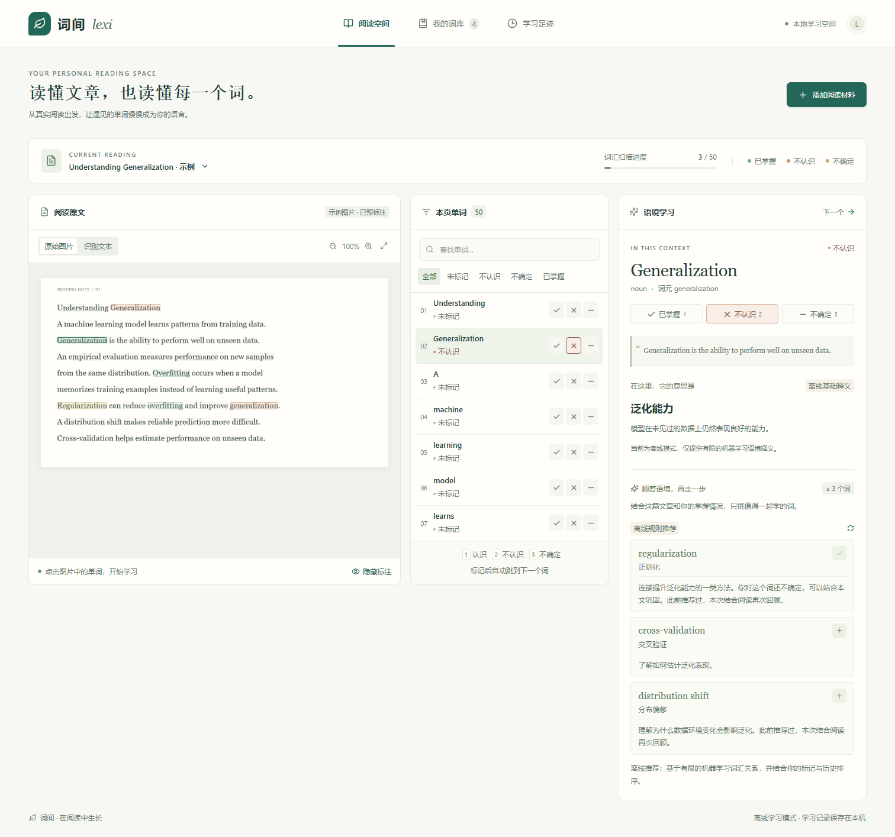

# MVP 验收记录

## 个性化学习计划与自适应复习（adaptive_v2）

- 今日计划提供 10、20、30 分钟预算，偏好按后端地址、部署项目及当前学习身份隔离。预算利用有效的显式复习用时估算时间容量；现在到期词才进入队列，稍后到期词用于今日计划显示但不会提前安排。每组最多 10 张卡，预算变化不替换当前组或待确认自评。
- 排序原因、优先级和记忆状态来自有限的显式复习历史，以及当前标记状态、规则掌握度、逾期时长和阅读出现次数。后续间隔对近期显式自评与有效作答耗时作有界调整；无效/缺失耗时不会作为测量样本。隐藏页面/离开复习时计时暂停，pending 重试保持原 UUID 和冻结耗时。
- 兼容性：复用已有学习事件详情与复习排期，无数据库迁移；缺少新增详情字段的旧事件仍可读取，旧版请求可继续不带新字段；浏览器版本 1 未完成组仍可恢复。无 AI/Agnes 调用。
- 后端全量 `python -m pytest backend/tests -q`：**1963 passed**；其中最终复习/自适应专项 `test_spaced_review.py + test_review.py` 为 **91 passed**。覆盖 10/20/30 分钟边界、仅取到期词、显式 ID 恢复组不被剩余预算截断、用户与时区隔离、预览/落盘间隔一致、严格耗时校验及 UUID 重试不重复记账；仅有既有 ZIP 重名测试警告。
- 前端全量 `npm test`：**332 passed**。覆盖身份隔离预算、损坏数据归一化、降低预算不改写真实完成数、可见作答计时、隐藏页面暂停、旧组恢复、冻结 pending 请求和动态间隔文案。
- `npm run build`：TypeScript 与 Vite 生产构建通过；仅保留既有主包超过 500 kB 的提示，无编译错误。
- 合成浏览器 **9 组**通过：阅读页精简计划、10→20→30 分钟切换/刷新恢复、进入今日计划、原因/状态/动态间隔、隐藏时间不计入、丢失响应完整复用原 PUT、零 AI 请求，以及 390px 无横向溢出、角色可见且不遮挡控件。报告 `work/qa-adaptive-plan/report.json`，截图 `work/qa-adaptive-plan/mobile.png`。
- 正式服务只读 `/api/review?plan_minutes=20` 返回 `adaptive_v2` 计划和卡片；验收未向正式库发送复习写请求。验收前后逐表行内容指纹一致：18 张表、10,510 行无变化，`.env` SHA-256 亦一致。
- 规则与取值边界：[`docs/ADAPTIVE_REVIEW_V2.md`](docs/ADAPTIVE_REVIEW_V2.md)。

## 阅读续接与本地数据保障（2026-10-26）

- 新的浏览器续接记录按后端、项目与学习身份隔离，最多保存 30 篇；内容指纹会使校对后的旧坐标失效。文字锚点/偏移与比例回退、PDF 页码/页内位置、图片视图/缩放/双轴位置均有覆盖，页面隐藏、离页和快速换文档会立即落盘。明确从复习/记录返回的 occurrence 优先，手动书签与“从头开始”互不清除。
- 自动续接仅写浏览器存储，没有调用学习写接口。浏览器 5 组覆盖长文刷新、180ms 内快速换文档、PDF 页内位置、图片 150% 缩放与双轴滚动、从头开始保留手动书签；存储损坏、超限或禁用时安全回退。
- 自动恢复点只在应用启动或打开数据管理页时检查；距上次成功已满 24 小时才创建，强制按钮可立即创建，默认保留 7 份。创建前执行 SQLite `quick_check` 与外键检查，写完后用既有完整备份校验器复验 ZIP，并保存 SHA-256、大小与时间；状态与最新下载只认可元数据拥有且摘要匹配的文件。失败不删旧恢复点，并发请求合并，公开模式接口为 404。
- 后端自动/手动备份相关 **50 passed**，覆盖到期、强制、轮换、逐份损坏与尺寸预检、失败保留、并发、权限及既有导出/预览/恢复；前端全套 **328 passed**，TypeScript/Vite 构建通过。数据管理页的刷新、立即创建、最新下载、完整性状态、7 份保留说明、同盘风险提示及 390px 无横向溢出通过合成浏览器检查。
- 没有新增数据库迁移或依赖，自动恢复点继续使用现有完整 ZIP 格式。自动恢复点与正式库默认同盘，只覆盖本机误操作和文件损坏场景；硬盘损坏或设备丢失仍需把 ZIP 定期下载到其他磁盘或可信存储。

## AI 等待体验（2026-10-26）

- 新字典与助手 SSE 接口复用原业务验证/鉴权/预算/缓存；真实模型增量提取摘要或回答草稿，出题不发送草稿。缓存命中仅 result，失败/截断不当作完成内容；明确不兼容时仅同一业务预算内回退一次普通响应。
- 共享等待组件显示事实阶段、已用秒数及 15 秒提示，无百分比估算。停止、切词、离页和错误清草稿；普通非流式请求仅停止前端等待。词典弹窗无需关闭即可停止；短文保留请求 UUID，助手停止保留输入且阅读旧对话时不自动拉回底部。
- 前端 **319 项**、后端传输/流式/增量 JSON/字典/助手 **180 项**、TypeScript/Vite 构建通过；无新增依赖、学习库迁移或数据资产。上游 SSE、本机真实 HTTP 阻塞取消、缓存不写半成品、错误脱敏、上下文复查、预算和回退边界均有覆盖。
- 合成浏览器 **11 组**与助手额外 **2 组**通过，涵盖三个词典入口、助手流式与出题无答案预览、停止/截断/错误/重试、时钟推进慢响应提示、语境/句子/文章取消、短文 UUID 重试、复习揭晓与自评、1440/800/390/340 和低动态、旧对话滚动保留及 340×260 停止入口。合成写入均被测试路由拦截。
- 真实 Agnes 一次 19 字简短回答验证阶段为 connecting→generating→validating，2 份真实草稿，首份约 2.996 秒、完成约 3.09 秒；非性能保证。读取既有 eye 缓存的 SSE 仅 result，无模型生成；错误输入返回 HTTP 422。本地服务已重启。
- 报告 `work/qa-ai-waiting/report.json`、`assistant-extra-report.json`、`live-agnes-report.json`；说明 `docs/AI_WAITING.md`。

## 查词体验增强（2026-10-26）

- 新只读 `/api/dictionary/suggestions/query` 提供最多 8 个本地候选词及中文简释；双段路径保留英文 `suggestions` 的普通查词。共享不可变只读词典连接及锁，前缀池最多 512、编辑候选最多约 2900、IN 参数分批 400，全程索引查询，不读取全量词典、不调用远端、不写学习事件。
- 候选由原词典字段完整度、词形与拼写距离等排序，不冒充词频数据。拼写只覆盖长度 3–48 的一次插入/删除/替换/相邻交换，不强制纠正合法原词。真实 aple→apple、recieve→receive、resiliant→resilient、headmster→headmaster 均为首项；单组 100 次进程内查询中位数前缀约 0.05–1.2ms、拼写约 0.5–1.0ms，不包含浏览器和 HTTP 开销。首次派生词典缓存解压约 346ms。
- 输入防抖 200ms、独立中止及响应身份校验；支持 ARIA combobox/listbox、上下键/回车、Esc、Tab、鼠标/触摸与 IME 组合输入保护。候选与拼写接口异常不会阻止普通查词；正常未收录才显示拼写按钮，不自动替换、生成讲解或写入词库。
- 12 条查询历史使用现有学习空间隔离 key；损坏数据清理、加载时合并新查询、清空后不复活，存储禁用时保留内存使用并提示。恢复备份清理本空间历史，其他空间保留。
- 前端全套 **307 passed**（新增 8 项历史读写、1 项备份清理）；后端新候选 **51 项**、现有 dictionary **26 项**及 offline_dictionary **38 项**分轮通过。构建通过；无新依赖、学习库迁移或额外数据资产，原主包体积提示仍在。
- 浏览器新增 **9 组**通过：防抖/键盘与点击/Enter原词/Escape/绿色内框回归、旧候选不覆盖/IME/服务降级、拼写确认不自动写入/离页取消、刷新恢复/历史顺序/身份隔离/清空、存储禁用降级、1440/800/390/340 四种宽度；原查词 **7 组**回归通过。合成写入均在测试路由拦截，未调用真实模型或修改实际词库。
- 另用触摸设备上下文验证候选和拼写按钮的 tap 选择，未被失焦吞掉、无重复查询或学习写入，报告为 `work/qa-lookup-enhanced/touch-report.json`。
- 本地后端已重启；真实只读候选接口、四个拼写样例与英文 suggestions 普通查词返回正确结构。报告见 `work/qa-lookup-enhanced/report.json`、`work/qa-lookup-enhanced-regression/report.json`。

## 独立查单词（2026-10-26）

- 左侧「查单词」独立入口，英文单词/短语回车查询后内联显示全部中文义项、音标、词形及缓存详细讲解；共享发音设置，查询结果不主动预取音频。输入校验覆盖长度、URL/路径/中文拒绝及兼容弯引号/空白。
- 仅明确点击才调用墨墨或 AI；支持停止等待，连续查询/离页使旧响应失效。最近 12 条仅在内存保留，可重查或清空。
- 显式加入默认不认识；使用结果词形保存、词元识别已有条目，当前状态按钮禁用，保存有同步防重锁、全局导航锁和失败重试。新增词立即同步我的词库；普通查询不写学习记录或复习计划。
- 前端全套 **298 passed**（含 7 项查询规范化与历史测试），相关后端 **79 passed**（本地/内存临时库隔离），TypeScript/Vite 构建通过。无后端代码、数据库迁移或新依赖；保留原主包大于 500 kB 提示。
- 浏览器 **7 组通过**：独立入口/校验/只读查询/词元匹配/防重保存/失败重试/词库同步；查询失败重试/切词和离页丢弃迟到响应/未收录不自动调用 AI/最近查询复用与清空；显式墨墨与 AI/缓存/停止与切词离页；1440、800、390、340 四种宽度的结果和操作控件布局。所有测试写入拦截到合成接口，无实际学习数据写入或模型调用。报告在 `work/qa-dictionary-lookup/report.json`。
- 另通过真实本地只读接口确认 eye、headmaster、Banks、take into account 均有本地中文释义。

## 更多角色动作与台词（2026-10-26）

- 动作从 5 项扩为 **10 项**：新增挥手、拍手、翻书、哈欠、认真思考。内置图像工具根据已确认角色生成独立 1536×1024 RGBA 双帧动作图集，保留透明通道、提示词及哈希收据；四个动作仅在有效手动交互时播放 1.6–2.2 秒，思考复用已有姿态。
- 首次需要时离屏加载并解码动作图，就绪前保留原角色，坏图只失败一次并回退；迟到加载仅缓存，不延长或重播旧动作。新计时只调度下一帧边界，拖动/取消/卸载/重要学习状态清理；低动态只显示静态代表帧。固定尺寸、原比例、按钮安全区保持。
- 台词为 **123 句、34 组**，覆盖九个页面、十种动作及真实学习事件。按组保留最近三句，普通台词 2500ms 间隔；菜单「说句话」独立 1200ms 冷却，不触发动作或 AI，两项点击偏好关闭时仍可主动使用，不能覆盖等待中的 AI、结果或错误。切换页面只更新场景，不主动说话；未新增学习数据写入。
- 新增 **17 项**有意义测试（动作 5 项、台词/状态 12 项），前端全套 **290 passed**，TypeScript/Vite 构建通过，保留原主包大于 500 kB 提示；无新增依赖、后端改动或迁移。
- 新浏览器 **6 组通过**：十动作入口及完整双帧/自动结束、九场景映射的单元覆盖与阅读/词库/复习页面主动台词、最近台词去重/两个开关关闭后主动说话、AI 优先、慢图不空白/迟到不重播、坏图只请求一次、手机低动态和 340×260 小窗口菜单。合成学习业务 **9 组**、原交互 **10 组**、Agnes 对话 **4 组**回归通过；台词来源按当前内容分组校验，避免将新增合法句子误判为旧固定文案回归。
- 本机首页、主 JS/CSS、按需助手 JS/CSS 和两张角色图集共 **7 个文件**与磁盘构建逐字节一致。正式 SQLite **18 张表**及 `.env` 在校验前后指纹一致；报告和截图在 `work/qa-mascot-more-actions/`。

## 参考图角色形象改造（2026-10-26）

- 内置 `image_gen.imagegen` 根据用户提供的蓝发 Q 版参考图生成一套 1536×1024、4×2 的 RGBA 图集。验证真实透明通道及八个主体，生成文件原样复制进源码；提示词、参考图哈希及最终图片哈希一并保存。没有用脚本重绘或移除背景。
- `mascotArtwork.ts` 将八种既有学习状态映射到独立静态姿态，业务状态优先于点击动作；默认不加载原立绘或旧摸头 GIF。保留手绘缺图兜底及旧单图素材配置兼容。新增源图调整元数据，避免思考格出现邻格头发、讲解格裁掉左侧发梢。
- 图集保持 3:4 比例，底部保留 24px 给「问 Lexi」和菜单，脚部不被遮挡。未改变 Widget 固定尺寸、坐标、拖拽、停靠、气泡或学习事件；低动态只静态换姿态，图集不是逐帧行走动画。
- 前端全套 **273 项通过**，新增 **7 项**覆盖八姿态坐标、无效图集/裁切、学习反馈优先、旧 GIF 隔离、跨状态缺图记忆、legacy 与低动态。TypeScript/Vite 生产构建通过，保留原有主包大于 500 kB 提示。纯前端素材改造，无后端代码、依赖或迁移。
- 新图集浏览器 **5 组通过**：八种真实事件驱动姿态、原比例与安全裁切、桌面 96px/手机 72px 固定外框、按钮预留、滚动/低动态/点击、无旧素材请求、缺图只回退一次；故障与学习写入只使用合成数据。原交互 **10 组**、学习业务 **9 组**、桌面/手机三档大小与滚动 **2 组**、Agnes 助手 **4 组**回归通过，包含触屏、拖动取消、模态、快捷键、七种窗口、停止/迟到/重试和上下文交接。
- 本机服务启动后，首页、主 JS/CSS、按需助手 JS/CSS 与角色图集共 **6 个文件**均与磁盘构建逐字节一致；SQLite **18 张表**及 `.env` 在本机校验时指纹不变。报告、截图及资源校验在 `work/qa-mascot-redesign/`。

## 复习词卡完整注解与墨墨优先（2026-10-25）

- 根因复现：ReviewPractice 遇到没有 occurrence 的复习词直接跳过释义，而本机已标注的 58 个词均无关联原文。改为独立预读通用词典，揭晓后显示中文全部义项、音标、词形、墨墨个人内容和已缓存详细讲解；原句讲解独立按需请求，不生成虚构语境。
- 新墨墨内容客户端依官方接口只读本人释义/例句/助记，过滤删除内容、校验词身份、条数/大小/时间/错误结构；复用全局节流，用户及 Token 指纹缓存隔离、空结果/错误缓存、冷却刷新、失败保留旧注解。公开模式不开放个人数据，GET 无远端调用；新 POST 不触发 AI。Token 不进入响应和缓存。
- 揭晓后先读墨墨；没有中文释义和双语例句时自动单次补充当前词的 Agnes 课程，可关闭自动补充并跨卡保持，可停止等待/重试/快速前往自评。停止、换卡、切页有取消信号与作用域保护，迟到请求不污染当前词。不是全库静默批量生成。
- 当前本机词库 **4427/4427** 有中文注解：4423 条 ECDICT，4 条词间精确补充，附原创双语例句/用法/来源。`honourary` 明确提示核对标准拼写 `honorary`，不改原词或学习记录。
- 全后端 **1809 passed**（含注解客户端、隔离/缓存/失败/并发/只读及补充词典）；前端 **266 passed**，TypeScript/Vite 构建通过，保留已有主包大于 500 kB 提示，无新增依赖或数据库迁移。
- 合成浏览器 **5 组通过**：无原句导入词、揭晓前隐藏/无远端、墨墨内容优先、完整详细讲解、切卡迟到、显式语境、手机无横向溢出、停止/失败重试、缓存复用/共用弹窗，以及缺少墨墨内容时单次自动 AI、关闭跨卡保持/重新开启。没有真实学习写入或意外 API。
- 真实墨墨 `eye` 内容查询成功，个人释义/例句/助记为空（不是官方词典缺失），5.00 秒，重复请求命中空缓存。真实 Agnes 为 `eye` 生成 4 义项、3 搭配、4 用法提示、2 易混辨析，单次 37.34 秒，随后 GET 直接读成功缓存；不承诺首次模型固定耗时。
- 本机验证的 SQLite **18 张表**及 `.env` 指纹不变。正式库当次没有到期卡，未为演示重排复习；页面有卡的流程使用合成数据验证。报告和截图在 `work/qa-review-annotations/`。

## Lexi × Agnes 学习助手（2026-10-25）

- 新增显式 `/api/assistant/messages`，支持 chat/explain/memory/quiz。服务端验证用户/文档/出现位置归属、生成期间正文变化、输入与模型结构，读取最多 8000 字符文章片段并限制输出至 1600 tokens。没有保存会话、新建数据表或生成学习事件；公共模式仍适用既有模型预算。
- 页头与角色下方「问 Lexi」、设置菜单、词典「和 Lexi 学这个词」均可进入。当前阅读上下文经独立 Provider API 传递，正文指纹与词条变化隔离会话；其他页面是独立英语问答。面板按需加载，原角色大小和停靠点保持。停止/关闭/换词取消请求与 operation，迟到结果不回写 UI。
- 四选一在确认作答后揭晓，已回答题的选择与解析进入后续历史，未回答题不带答案；最近 3 条有效历史、500 字输入、12 次成功回答上限。模型不可用明确展示错误及重试。面板开启期间阻止焦点落到 body 时误触学习快捷键；七种窗口含矮屏的关闭/停止均可点。
- 新后端 **68 项**、前端 **8 项**专项通过；全后端 **1761 passed**、前端 **260 passed**，TypeScript/Vite 构建通过。全量校验发现原关联测试读时钟固定在 10-24、真实反馈写时钟已到 10-25，修复仅限测试 fixture 同步时间，保留显式未来事件；无关联业务代码改动。
- 新浏览器 **4 组通过**：讲解/记忆/出题/追问、选择揭晓及历史、轮次上限/清空/焦点恢复、无自动请求、停止/失败重试/迟到、切词、原词典弹窗交接、通用问答、无学习写入、固定角色及七种窗口。原挂件 **10 组**与业务 **9 组**回归通过。
- 真实 Agnes 已通过本机 API 验证单词讲解及四选一，额外复核单词填空题；记录为实测单次耗时，不作固定延迟承诺。报告与合成截图在 `work/qa-agnes-companion/`，模型密钥未进入前端或日志。
- 本机首页、主包及按需面板共 5 个文件与磁盘构建逐字节一致。`.env` 保持不变；初始指纹后、助手路由启用前，正式库出现 5 笔已掌握标记（10:35:29–10:35:40 UTC），相应学习记录/复习/词库/操作表变化均保留，未回退。最终 UI 验证前后 **18 张表指纹一致**，详见 `main-data-observed-changes.json` 与 `final-data-report.json`，不将开发期间已有学习操作误报为“全程数据不变”。

## 阅读助手固定尺寸与持续显示（2026-10-25）

- 前次修复仍保留空位不足时缩小/收起/隐藏的策略，不能满足固定大小与持续可见。现移除 Widget 的 mini/edge 分支、空位不足 return null、气泡缩小角色及组合搬动；停靠几何只依赖用户设置、视口与导航布局，不读取随滚动变化的正文障碍。
- 左侧停靠在侧栏右边，右侧保持原偏好；边界夹取不保存临时坐标。台词先寻找正文外空白，再尝试避开控件的悬浮气泡。固定位置没有安全台词空位时保留单个可访问状态，不能为台词搬动角色。保留主动隐藏、专注/模态抑制及有限动作。
- 前端 **252 passed**，重写固定停靠 7 项测试（含 100 组生成视口）并新增气泡固定角色 4 项测试；TypeScript/Vite 构建通过，无依赖、后端或业务 API 变更。原有 Vite 500kB 提示仍存在。
- 隔离浏览器 **384 次滚动采样通过**：左右偏好、1440/1024/768/390px、三档大小、阅读及含 107 词的词库；每次角色完整图片可见、中心可点，外层 x/y/宽高不变。问候、设置与实际双击摸头不改停靠尺寸/位置；窗口、键盘高度和横竖屏切换保持边界内。原挂件交互 **10 组回归通过**。
- 台词回归 **3 组通过**：七种窗口的日常/错误台词保持 10px 相邻间隔与正确尖角，拖动、松手、缩放、关闭及菜单可用。放大字体后没有安全空位时仅保留单个可访问状态，角色尺寸/位置不变。
- 18 张 SQLite 表及 `.env` 指纹相同；8000 首页及最终 JS/CSS 与磁盘构建逐字节一致。报告、截图与校验在 `work/qa-mascot-fixed/`。下方记录为历史版本，当时的自动缩小/收起策略已被本次替代。

## 阅读助手滚动避让修复（2026-10-25）

- 根因：标题留白滚出视口后，完整及迷你角色放不下；旧边缘搜索仍遍历全视口，可能跳到左侧空隙，并把 52×62 图片裁入 12/32px 窄条。新增 `mascotRestingPosition.ts`，完整/迷你布局保留在所选半侧，收起入口只在所选物理边缘搜索安全纵坐标，找不到则暂时隐藏。
- 收起模式使用明确的叶片入口，不加载/绘制裁切角色。点击或键盘激活打开设置；收起设置解释恢复行为并隐藏无法预览的动作按钮。气泡组合也不能把角色带去另一侧或挪走边缘入口。滚动不会写入用户偏好，原拖拽仍可主动换边。
- 前端 **249 passed**，新增 **8 项测试**，覆盖右侧受阻/左侧空闲的原始跳边复现、左右对称、视口偏移、窄窗口、保护间距、不变性及 100 组生成布局；TypeScript/Vite 构建通过，无新增依赖或后端改动。
- 新滚动检查 **2 组通过**：1440/1024/768/390px、左右偏好共 **64 次滚动采样**，15 次收起均没有原图残片、保持所选侧/边缘且不遮挡内容，收起设置可用，返回留白恢复；活动台词滚动也不换边。原挂件 **10 组**及台词 **3 组**回归通过，覆盖双击、拖动/取消、吸附、设置、模态、触屏、低动态、七种窗口的日常/错误台词和字号变化。
- 浏览器 API 为合成数据，无真实学习写入、AI/OCR/音频生成、意外请求或页面异常；18 张表及 `.env` 指纹不变。8000 首页/JS/CSS 与最终磁盘构建一致，报告及截图见 `work/qa-mascot-scroll/`。

## 阅读助手台词定位修复（2026-10-25）

- 复现旧布局问题：气泡独立寻找固定 82px 空位，1024/768/390/340px 和矮横屏可能退为隐藏台词；桌面侧向气泡的尖角仍朝下。改用四向相邻布局，角色与气泡边缘相距 10px，箭头指向角色范围。按真实换行、字号和高度测量，优先保留角色位置，再尝试窄气泡及组合避让；拥挤时仅临时缩小已有迷你角色。不改用户保存的大小或坐标。
- 新增 **8 项几何测试**：四个方向、尾巴对齐、固定角色附近的窄空位、组合移动、视觉视口偏移、极端边界及 100 组生成布局。前端 **241 passed**，TypeScript/Vite 构建通过，无新增依赖。
- 新布局浏览器 **3 组通过**：1440×1000、1280×720、1024×768、768×900、390×844、340×640、844×390 各自的日常/错误台词均可见、无遮挡、间距/箭头正确、正文无横向溢出；实际鼠标双击摸头仍正常；拖动收起、松手/窗口变化后重接、关闭、设置不被避让覆盖；字号变化后重新测量、隐藏副本不产生额外 live status。菜单到期补充检查确认位置不跳，body 焦点下 Escape 正常。
- 原挂件 **10 组**及业务 **9 组**回归通过。双击目标 360ms 内锁住实际尺寸与位置，取消/失焦/卸载清理；菜单打开时不计算台词组合。只读复核提出的尺寸锁和菜单到期跳位两点均已修复。
- 全部使用合成 API，无真实模型、OCR、朗读或学习写入；18 张表及 `.env` 前后指纹一致。8000 首页与最终 JS/CSS 对应本机构建，报告/合成截图见 `work/qa-mascot-bubble/`，定位浏览器脚本为 `work/browser/mascot-bubble-check.mjs`。

## 阅读助手角色互动增强（2026-10-25）

- 范围仅为独立挂件模块与文档，保留原角色和原业务接入。新增有限动作纯 reducer、同步 ref 的稳定 API、实时 reduced-motion hook，无新依赖、后端或学习事件。
- 前端 **233 passed**，含新增 **11 项互动测试**：立即单击、不连续重复、320ms 双击、摸头不可续时、450ms 冷却、替换计时器、取消/关闭、AI/错误优先、可选低优先级台词、旧配置迁移。TypeScript/Vite 构建通过；既有入口包大于 500kB 提示保留。
- 新增互动浏览器 **7 组通过**：原版摸头 GIF 128px 实际加载并结束后回到原图；五种菜单动作有限且无队列；关闭偏好刷新保留、拖动/失焦重置双击；低动态初始不请求 GIF、实时切换立即停止；AI 中断且不覆盖状态、菜单数字/下一词键和 body 焦点隔离、Escape；缺 GIF 一次回退；1440×1000、390×844、844×390 菜单有界且可滚动。手动动作后收菜单，实际阅读页面额外确认气泡不遮角色。
- 原挂件 **10 组**及业务联动 **9 组**回归通过，保持拖拽、取消、吸附、触屏、模态、尺寸/隐藏、原图兜底、1/2/3、反馈原 UUID、取消/迟到响应与缓存语义。所有 API 为合成响应，无意外请求或页面异常，无真实模型/OCR/朗读或学习写入。
- 正式 **18 张表及 `.env` 指纹一致**。8000 首页、最终 JS/CSS、PNG/GIF 与磁盘构建逐字节相同。原图及新增原版 GIF 均位于 Git 忽略目录；未发布公网。只读复核提出的 Escape/手机菜单遮住动作问题已修复。
- 报告、合成截图和数据指纹在 `work/qa-mascot-enhancement/`；新浏览器脚本为 `work/browser/mascot-interaction-check.mjs` 与 `mascot-interaction-preview.mjs`。实现与素材细节见 [阅读助手说明](docs/MASCOT_V1.md)。

## Lexi 阅读助手 V1（2026-10-25）

- 第一阶段完成独立挂件/设置/拖拽/气泡后构建通过，再接入业务并构建；最终 TypeScript/Vite 构建通过，无新增依赖。Vite 仍提示既有入口包大于 500kB，非失败。
- 前端 **222 passed**，新增 **12 项纯状态/配置 + 7 项几何**测试，含优先级、冷却、并发取消、迟到结果、真实计数、反馈去重、坏存储、吸附和 120 组生成布局。
- **10 组挂件浏览器验收**：台词不连续重复、4 秒关闭、不抢焦点/滚动；设置/隐藏/恢复/刷新记忆；菜单数字键隔离；1:1 捕获、取消、不提交坏位置；左右底部吸附/镜像；Q 弹、右键、长按；原有 1/2/3 与专注/导入/词典互斥；1440/1024/768/390/844×390、滚动、短视口与设置不被临时避让覆盖；reduced-motion；CDP 触屏及 touchcancel；本机原图正常加载、缺图仅请求一次并显示兜底。
- **9 组业务验收**：300ms 前立即响应且切词取消排队；成功仅原有一次 POST；真实错误/重试；offline 不伪装故障；实际渲染计数最多 3；SHOWN/VIEWED 不触发反馈反应；失败反馈不庆祝、原 UUID 重试成功在慢统计刷新前响应；空推荐中性提示；词汇拓展停止/迟到/会话缓存；关系页确认保存。
- 既有阅读动效 **10 组回归通过**：四态、选词同步、75/100/125/200% 词框对齐（最大误差 <0.015px）、快速 1/2/3、显式 AI、反馈 UUID、内部滚动、专注锚点及低动态。快捷键确认并自动下一词约 54/56/62ms（合成接口，非真实网络延迟承诺）。
- 浏览器 API 全部模拟，无真实模型/OCR/音频生成、学习写入、意外请求或未捕获页面异常。正式 **18 张表及 `.env` 指纹前后相同**。8000 最终首页/JS/CSS/角色 PNG 与磁盘构建逐字节相同。
- 按用户要求接入原项目图片，本机文件 hash 与固定上游原图一致；图片/本机构建目录被 Git 忽略。上游素材不在 MIT 范围，公开构建需替换或取得授权；无上游代码、音效、DSH 或账本依赖。
- 工作目录报告：`work/qa-mascot/ui-report.json`、`business-report.json`、`served-report.json`、`main-data-baseline.json`；独立审查未发现阻塞问题。详情见 [V1 设计与文件说明](docs/MASCOT_V1.md)。

## 阅读交互与反馈增强（2026-10-24）

- 范围仅为现有 React/CSS 前端：统一 120/180/280ms 动效；没有安装依赖，没有改后端/API/数据库/算法/学习事件定义。
- 稳定语境面板外框，保留逐 occurrence 的请求重置、300ms 主动查询防抖和中止；选中不触发 LOOKUP，推荐生成不触发 VIEWED。关联卡只有主动展开记录 VIEWED，可见性观察仍在稳定 article 上，UUID 及失败重试逻辑不变。
- OCR 只过渡颜色与轮廓，image/stage/overlay 不变换。原图/识别文本以常驻且隐藏面 inert 的方式淡切，真实 img onLoad 后显示词框。专注阅读锚点只读取当前面，修复切换后的不足 1px 舍入导致误选下一行。
- 确认状态变化后行反馈不等待动画完成；1/2/3 的既有保存互斥与下一词机制保持。进度直接显示真实值并使用原生 CSS 追赶宽度，数字不从 0 重数，不排队。
- Desktop >=1440 三栏均 720px，语境内部滚动；1024/768 两栏加下方语境，390 纵向。概览刷新保留上次结果并明确提示，关闭详情恢复来源焦点。关联页不增加图谱或虚构强度。Toast 退出后不重复读屏播报。reduced-motion 关闭新增过渡/动画，交互保持可用。
- 前端原有 **203 tests passed**，各阶段 `npm run build` 通过。**10 组隔离浏览器检查全部通过**，0 页面异常、0 未定义 API；覆盖四态、pane-only scroll、75/100/125/200% hover/selected 词框、连续快捷键、AI pending、三卡、SHOWN/VIEWED、反馈原 UUID 重试、详情焦点、四宽度、专注图文位置与字号及 reduced-motion。
- 合成图片词框定位误差最大约 0.015px，三次快捷键从确认写入到切词为几十毫秒量级；这是合成响应下的 UI 验证，不代表真实网络或 AI 耗时。图片专注退出恢复 scrollTop180，文字锚点误差不超过 1px。长语境滚动和关联展开不改变 window scroll。
- 报告和合成截图：工作目录 `work/qa-editorial-motion`，脚本 `work/browser/editorial-motion-check.mjs`。全部 API 使用合成响应，没有真实学习写入或 AI/OCR/发音调用；截图的词条与统计为测试样例。正式本机 **18 张表与 `.env` 指纹前后相同**。首页及 `index-CovKJrzX.js` / `index-DRyLQdY6.css` 与本机构建逐字节一致，健康接口200，后端无需重启。
- 修改文件、每处动效的用途及刻意省略的效果见 [交互说明](docs/INTERACTION_DESIGN.md)。刷新 http://127.0.0.1:8000 查看。

## 词库操作效率验收（2026-10-23）

- 词库逐词勾选、选择本页、跨页最多 200 词；本页 checkbox 支持键盘及半选状态，筛选搜索/掌握状态/墨墨来源/分组时清空选择。分组先筛选再分页，选择只保留在本次打开的词库页面，原有浏览记忆格式不变。单行及批量标记在首次编辑时冻结已掌握排序分组，保留当前页和位置；不符合筛选的词仍正常移出。
- `POST /api/vocabulary/batch` 使用 UUID 与选择时版本快照，`BEGIN IMMEDIATE` 内整批校验归属、版本后保存状态、掌握度、排期和回执。同状态词不重复学习。响应不确定时锁住编辑、导航及导入入口，重试完全相同 payload；重复或迟到请求返回当前状态，不重放旧修改。
- 撤销最近一次有改动的单行/批量标记，恢复此前状态/掌握度/排期，包括未标记与不存在排期的情况。撤销前比较最新词条、学习事件和排期，后续查词、标记、文章遇见等导致整批 409；只读查看不阻止撤销。原 MARK 事件保留编号并重分类为已撤销记录，另存撤销审计，不混入有效标记统计。updated_at 保持递增，避免撤销使旧版本重新有效。撤销入口在离开/刷新词库后不保留，服务端回执仍幂等。
- 自定义分组新建、重命名、删除、批量加入/移出和筛选，最多 50 组、1–30 字，规范化并忽略大小写去重。删除分组保词，分组操作不修改学习状态、计数、事件或排期。组 ID 不复用，所有成员跨用户归属校验后原子保存。删除当前组的响应丢失后，重读也能解除失效筛选并清空选择。
- 新增三个独立表与 `013_vocabulary_tools` 加法迁移。升级前 SQLite 在线备份，不改原词库/文档字段。完整备份严格检查分组、成员和回执的结构、归属、快照及事件关系；支持上一版 012 备份，仅恢复已验证的数据行并补齐空的新表，不执行备份 DDL。深层无效 JSON 返回 422，迁移失败回滚可重试。
- **后端全套 1289 passed**（159.89s），随后补充 JSON 边界并完成最终升级/备份 **5 passed**；包含批量/撤销 41 项、分组 42 项、恶意工具备份校验 68 项及原有复习、统计、备份、用户隔离回归。前端 **102 passed**，TypeScript/Vite 构建通过。
- **9 组模拟浏览器检查通过**：200 词跨页选择、第二页冻结/批量/空状态撤销；丢响应同 UUID 重试及入口锁；409 重读和解锁；单行成功撤销与后续冲突；组 CRUD/多组成员/121 词分页前筛选；键盘半选和原浏览记忆；删组丢响应后失效筛选清理；380/340px、30 字组名、手机顶部菜单与操作栏避让。没有 JS 异常、未知 API 或真实个人写入。
- **真实 API 端到端通过**：端口 8003 的独立数据库与 `Settings(_env_file=None)`，无 API mock、外部请求、Agnes 或墨墨调用。UI 导入公开合成文章得到 17 词，标记 2 词后撤销回 null 状态/null 分数/空排期，新建分组、加入两词、筛选两词、删组后仍保留 17 词；核对一个已撤回执与两条重分类/两条撤销事件，删组不改学习记录。测试服务已停止。
- 验收报告、合成截图和独立数据库保留在工作目录 `work/qa-vocabulary-efficiency`。正式升级前完整安全备份已保存；原有 15 张表指纹（排除新增 013 版本行）及 `.env` 保持不变，新三表为空。8000 已载入新后端，启动器记录同步，首页及 `index-BQhhiQ23.js` / `index-CUriuuJn.css` 与最终构建逐字节一致。

## 旧版 Logo 与 Agnes 等待优化（2026-10-23）

- 恢复 c5c4812 之前的 Leaf 主标：浅绿底、深绿 21px 叶片、38×40px 历史圆角；页脚同步，favicon 恢复深绿底白 L。1440/390px 两组检查通过，没有导航及布局改版。
- LLMService 复用线程安全 HTTPX Client：最多 4 组独立配置，凭证使用摘要隔离且逐请求传入，每组最多 8 个连接、4 个空闲连接；活动请求不会被淘汰关闭，退出清理空闲连接，无自动重试。schema/用户 JSON 仅移除编码空白，保留所有字段与完整校验、详细释义、原有 token 预算。loopback HTTP/1.1 测试验证两个服务实例连续调用只建立 1 个 TCP 连接。
- 句子上下文为所选句附近最多 2,400 字，原句更长则完整保留（仍受 4,000 字原句上限约束）；保留 Unicode 原文及 PDF 页边界，不再截取页首 12,000 字。缓存版本更新，身份含页尾和实际上下文 hash，避免不同位置的重复句或重新分页混用。提示词减少重叠分句与重复语法说明，不为不及物动词虚构宾语；这是提示约束，不是语法正确性的保证。
- 前端在文档作用域内保存最多 32 条成功句子解析。同一次原句切换单词直接展示，重复原句通过真实位置隔离，无可靠 OCR 位置则逐 occurrence 隔离。文档/正文/页范围/校对修订变更即失效；失败、取消、不匹配原句的响应不入缓存，保留原 ContextPanel key、查词副作用及中止逻辑。句子、详细释义和短文生成采用 ThoughtLine 实际计秒，不生成虚假阶段或进度。
- 后端全套 **1132 passed**；随后补充重复句与分页两项测试，并完成句子上下文/句子服务 **28 passed**、问答 **66 passed** 的最终定向回归。前端 **98 passed**，TypeScript/Vite 构建通过。**6 组 AI 界面检查 + 2 组 Logo 检查通过**：同句免重复 POST、重复句不混用、超时重试、切文档、OCR 校对后失效及 390px 三处等待布局，均模拟 API，无真实学习写入、外网请求或 JS 错误。报告见工作目录 `work/qa-sidebar-flow/agnes-wait-cache-report.json` 和 `leaf-logo-report.json`。
- 真实速度限制：优化过程中用相同公开原创短文进行 4 次未缓存调用。文章问答旧版 20.65s/中间优化版 57.50s，均通过引用验证；句子旧版 13.55s 后未通过格式校验，中间优化版 60.02s 读取超时。样本少且服务波动明显，**没有首次生成稳定提速的证据，不应宣传固定倍速或秒回**；后续简化了问答提示文本，未继续重复抽样。记录保留于工作目录 `work/agnes-performance-20261023/benchmark-results.json`。不传猜测的 Thinking 参数、不换模型、不降低完整释义、不将格式失败当成成功缓存。
- 15 张个人数据表与 `.env` 指纹保持不变；8000 已重启载入最终后端。首页及 `index-CtrXt567.js` / `index-C_NUh8_k.css` 与最终构建逐字节一致，桌面启动器进程记录同步。官方接口与传输依据：[Agnes 3.0 Flash](https://wiki.agnes-ai.com/zh-Hans/docs/agnes-30-flash)、[HTTPX Clients](https://www.python-httpx.org/advanced/clients/)、[HTTPX Resource Limits](https://www.python-httpx.org/advanced/resource-limits/)。

## 侧栏随页面滚动验收（2026-10-22）

- 仅桌面（至少 800px）将导航从视口固定改为相对页面容器定位，保留左侧宽度与起始位置。取消高度限制及独立滚动，鼠标在导航上使用滚轮时交给整页；短内容/矮屏由完整九个入口撑高，页面可滚动到最后一项。
- 手机保留原生抽屉、内部滚动、背景锁定、焦点约束和关闭返回行为。页面滚动时清理旧图标邻近反馈，并在卸载时清理监听。未改变正文、OCR、弹窗祖先的变换或业务逻辑。
- TypeScript/Vite 生产构建通过；没有依赖、后端、接口或数据库改动。
- **4 组定向浏览器检查通过**：1440px 长词库在左栏使用滚轮后整页移动 380px，导航 top 从 98px 变为 -282px、内部 scrollTop 始终为 0，旧图标邻近反馈已清理；844×390 短页九个入口撑高至 543px，滚轮和 Tab 均能通过页面到达末项且完整显示。390/340×420 抽屉仍在内部滚动 173px，背景位置不变，双向 Tab 循环、Escape 解锁及返回入口正常，无横向溢出。
- 检查全部模拟 API，无真实写入、外网请求、未定义接口或页面异常；报告与合成截图保留于 `work/qa-sidebar-flow`。8000 首页及 `index-kAF15AyR.js` / `index-D9YaMAxO.css` 与磁盘最终构建逐字节一致。

## 词库已掌握优先验收（2026-10-22）

- 我的词库对筛选后的全体结果按 KNOWN 优先、各组收录 ID 倒序排列，再切分为 50 词一页；其他状态不额外分级。顶部显示“已掌握优先 · 同组最新在前”。
- 首次标注时保留本次浏览的排序分组，此后连续标注、搜索和翻页不会因更新状态将词条移到顶部；状态徽章、数量和筛选条件使用实时值。重新进入或刷新词库时依据最新状态重新分组，界面说明标注期间保持原位。
- 浏览偏好增加可选 anchorId/anchorOffset，记录当前可见词及其相对视口位置；重入时先等待词库/必要的墨墨来源及展开记录，再查找新排序中该词所在页并恢复相对位置。主动筛选/翻页清理旧锚点，锚点不存在时回退页码夹紧和 scrollY。旧版默认值不新增字段；损坏、不完整或越界的锚点成对丢弃，不阻断学习。
- 前端 **96 passed**，新增 3 项锚点合法值、异常数据与旧偏好兼容检查，TypeScript/Vite 生产构建通过；无后端、依赖、接口或数据库变更。
- 原词库浏览回归 **12 组**和分页回归 **7 组**通过，覆盖 1440/1000/390/340px、4417 合成词/89 页、原位标注、筛选、词典、记录展开、导航往返/刷新、异步数据、存储受限与身份隔离、保存失败及末页夹紧。延迟墨墨记录使上方内容增高 30px 时，恢复锚点的屏幕位置误差仅 0.41px；因此此项验收比较同词相对位置，而非要求绝对 scrollY 不变。
- 已掌握优先专项 **8 组**通过：151 个交错状态合成词的全局排序、4 页无重漏、中文/来源筛选；1440/390px 双向修改状态和保存失败重试；筛选/分页期间冻结分组；异步 PUT 后重新进入/刷新，锚点从第 3 页移动至第 1 页仍恢复同词位置（最大误差 0.33px）；延迟来源及展开记录、筛选末页移出均正常。保存失败的提示区增高时按可见词条位置验收，不强求绝对 scrollY 不变。
- 合计 **27 组浏览器检查**全部模拟 API，无真实学习写入、模型调用、外部 HTTP 请求或未捕获页面异常。报告分别保留于工作目录的 `work/qa-known-first` 与 `work/qa-known-first-vocabulary`；8000 首页和 `index-TQ_os-yF.js` / `index-CkKbHkzx.css` 已与磁盘构建逐字节核对。

## 左侧导航与导入页精简验收（2026-10-22）

- 桌面导航恢复固定左栏（190px 宽），主区预留 222px，取消底部 Dock 的留白；844×390 短横屏可在导航内部纵向滚动。保留中文标签、活动页、数量和访客权限，图标继续有轻微邻近反馈，点击区域与文字稳定。
- 小于 800px 的屏幕改用页头菜单打开左侧抽屉，使用原生 dialog 隔离背景。支持 Escape、遮罩、同页返回菜单、切页聚焦标题、窗口放大后关闭清理及已有模态互斥。为首尾 Tab/Shift+Tab 显式循环，修复原生对话框在最后一项后短暂聚焦 body 的行为；切换页面采用 preventScroll，复习会话保留已有的当前词聚焦。菜单和触发按钮聚焦时，阅读数字/方向键不穿透；按钮使用实色底，滚动后仍清晰。
- 移除整个“读进去、记下来”宣传区及英文标语、说明、三步流程和相关 CSS，首页直接显示四种导入方式。首页标题改为“导入阅读材料”，图片弹窗仍明确图片格式与大小；三个实际学习快捷入口保留。
- 滚动展开由左右 5% 收边增至桌面 9%、手机 6%，最多前 220px 的自然滚动内展开到满宽，圆角 30→12px，投影同步减淡。实测桌面宽度 920→1021→1122px、手机 315→337→358px；缓存滚动终点以避免回流扰动，短页直接静态满宽，不添加无效高度。减少动态效果时满宽，正文和 OCR 祖先不变换。
- 前端 **93 passed**、TypeScript/Vite 构建通过，无后端、接口、数据库结构或依赖变更。
- **34 组原流程检查**：1440/1000/390/340px 的九导航、四导入、草稿及焦点、词典与复习、文章库、4417 合成词/89 页、原位标记和异步浏览恢复通过；390/340px 抽屉往返后词库位置恢复误差不超过 2px。
- **9 组效果/OCR 布局检查**：1440/390px 普通/减少动态、1440×1600 短页、移除宣传区、四导入/三个快捷入口、展开几何、正文/图片和 OCR 校对祖先稳定、选词与关闭返回焦点通过。
- **4 组导航专项**：1440×900、844×390、390/340px 的九入口、短栏纵滚、Y 方向邻近反馈、Tab 双向约束、CDP 无障碍树背景隔离与关闭恢复、滚动锁、各种关闭方式和切页焦点、数字/方向键隔离、导入/词典/OCR 弹窗互斥及 inert 恢复、尺寸切换清理和实色菜单按钮通过。
- 合计 **47 组浏览器检查**均在 API 边界模拟，**0 真实学习写入、0 模型调用、0 外部 HTTP 请求、0 未捕获页面异常**。桌面、手机与展开/抽屉合成截图已目视检查；报告保留于工作目录 `work/qa-sidebar-refinement`，汇总为 `final-report.json`。
- 个人 SQLite **15 张表**结构与逐行指纹、完整性和外键检查通过，`.env` 指纹不变。8000 首页及 `index-Bl8BLIPV.js` / `index-CkKbHkzx.css` 与磁盘最终构建逐字节一致；本机服务继续运行，代码仅本地提交。

预览均为合成数据：[桌面导入页](docs/sidebar-home-desktop.png)、[手机导入页](docs/sidebar-home-mobile.png)、[滚动展开](docs/sidebar-import-expanded.png)、[手机左侧菜单](docs/sidebar-navigation-mobile.png)。

## 绿色学习桌与场景动效验收（2026-10-22）

- 恢复森林绿、白纸与浅绿画布。水平品牌栏与底部浮动导航替换固定侧栏，主区最大 1480px；保留九个功能的中文名称、活动状态、真实词库数量与访客权限。页面底部和安全区预留空间，提示消息显示在 Dock 上方。手机页头布局修正，标题与添加材料按钮之间不再有多余的纵向空白。
- 根据指定 React Bits 示例独立适配，没有直接拷贝其大型 3D 实现、安装新依赖或请求远程字体/图片：
  - [Scroll Expand](https://reactbits.dev/animations/scroll-expand)：无文章首页的导入封面由左右 5% 收边随滚动展开到满宽，同时减小圆角；减少动态模式直接满宽。只更新封面尺寸，阅读正文、图片和词框祖先不参与变换。
  - [Animated List](https://reactbits.dev/components/animated-list)：文章列表前八项按 45ms 间隔有界入场，悬停/键盘焦点显示浅绿选区和侧线；词库仅淡入和背景反馈，状态更新时不重排、不移动整行或改变高度。
  - [Dock](https://reactbits.dev/components/dock)：桌面图标按鼠标距离放大，中心实测 1.38 倍、邻居约 1.06 倍，文字与按钮框保持稳定。鼠标离开清理，触屏不放大、内部横滑；焦点可逐项到达并自动只滚动导航，不移动阅读页面。
  - [Flying Button](https://reactbits.dev/micro/flying-button)：有效提问提交后，发送图标起飞并回归，保留原有提交锁和失败重试。
  - [Paper Crumple](https://reactbits.dev/micro/paper-crumple)：清空问答时纸片图标收拢后复原，保留中止请求、忽略晚响应和返回输入框的行为；为图标级适配，没有将对话或页面做 3D 揉纸。
  - [Thought Line](https://reactbits.dev/micro/thought-line)：真实问答请求期间显示光线及实际等待秒数；不显示虚构阶段或模型推理过程，隐藏页面停止计时刷新，成功/失败/取消即移除。
  - [Pulse Heart](https://reactbits.dev/micro/pulse-heart)：复习保存确认后心跳一次；揭晓、跳过和保存失败不触发，重复重试仍使用相同请求 UUID。
- 非必要动效遵循减少动态效果偏好，动效事件、按需 RAF、定时器和 Web Animations 在隐藏、离开或卸载时清理。Dock 导航聚焦时阅读快捷键不穿透；不变换正文、图片定位或模态祖先，校对与词典继续独立滚动。
- 前端 **93 passed**、TypeScript 与 Vite 生产构建通过。没有后端、接口、数据结构或依赖变更。
- **34 组原流程回归**：1440/1000/390/340px 下九个导航、四种导入和草稿、模态焦点、中文词典及长义项、复习揭晓/填空、文章管理、4417 个合成词/89 页、状态原位更新、分页及异步浏览状态恢复通过；保存失败、损坏/受限存储、身份作用域和末页情况保留。
- **8 组 Dock/滚动展开专项**：桌面邻近放大与稳定目标、启动禁用、减少动态、390/340 手机及 844×390 横屏逐项 Tab/Enter 导航、内部横滑、底部词库分页/数据操作避让、阅读键盘隔离及 OCR 祖先无变换通过；封面实测由 1209px 展至 1344px，左右收边由 5% 变为 0%。
- **5 组问答/复习专项**：有效单次提交、真实等待与隐藏生命周期、失败重试保留请求、引用定位、清空中止与晚响应、复习成功才心跳、相同 UUID 重试，以及 390px 触摸/减少动态模式通过。另暂停实际图标动画取样后恢复，查看了起飞、揉纸和心跳的中间帧。
- **12 组 OCR 布局烟测**：1440/390px 的图片与扫描 PDF 正文选词、100%/125% 图片词框位置、校对弹窗层级、背景 inert、Tab/Shift+Tab 约束、原图/编辑框可达、草稿放弃与关闭返回焦点通过；归一化词框误差小于 .003，校对层 80 高于 Dock 35，无横向溢出。
- 合计 **59 组浏览器检查**全部模拟 API，**0 真实学习写入、0 模型调用、0 外部 HTTP 请求、0 未捕获页面异常**。桌面/手机、问答中间帧和 OCR 工作台合成截图已目视检查；报告保留于工作目录 `work/qa-green-interactions`，汇总为 `final-report.json`。
- 个人 SQLite **15 张表**结构/逐行指纹及 `.env` 指纹不变，完整性/外键检查通过。8000 首页及 `index-Bgw9RbpA.js` / `index-Bz2R_tIU.css` 与磁盘构建逐字节一致；本机服务保留运行，并更新桌面启动器的精确进程记录，代码仅本地提交。

预览均为合成数据：[桌面导入页](docs/green-study-home-desktop.png)、[手机导入页](docs/green-study-home-mobile.png)、[桌面阅读](docs/green-study-reader-desktop.png)、[手机词库](docs/green-study-vocabulary-mobile.png)、[问答等待状态](docs/green-study-question.png)。

## 阅读手札视觉改版验收（2026-10-22）

- 用暖白、墨色与朱红建立界面识别；原创 SVG 标记用于侧栏、页脚及 favicon。序号目录、页码、中文衬线标题、英文书籍字体、细分隔线及小圆角控件贯穿主要页面，替换旧森林绿主题文件，未添加另一层主题文件、依赖或远程字体/素材。
- 首页为不对称排版与纸页式导入区，保留四种导入和三个真实学习入口；今日复习提示收紧。文章库改为单列编目，操作移至页边，手机自动折行；词库保留最新的简洁列表和状态按钮，阅读与词典使用正文/旁注层次。加深辅助文字，保留键盘焦点与减少动态效果支持，未对正文、图片坐标或模态祖先引入变换。
- 前端 **93 passed**，TypeScript 与 Vite 生产构建通过；没有后端、接口、数据结构或依赖变更。
- **9 组主要流程检查**：1440/1000/390/340px 的九个导航、首页快捷入口、四种导入与草稿、弹窗焦点约束/返回、中文词典与阅读快捷键隔离，无页面横向溢出；复习揭晓、填空输入跨导航保留，自评门槛及一次提交正常。
- **12 组词库浏览回归 + 7 组分页回归**：4417 个合成词、89 页、三种状态原位更新、记录展开、中文/状态/墨墨来源组合筛选、切换导航/刷新恢复页码与滚动、异步数据、身份隔离、存储异常、保存失败、CSV、末页与空库、跳转校验及窄屏单排页码全部通过。
- **6 组文章库及词典专项**：1440/390/340px 下，三篇合成文章的来源筛选、搜索、编辑标题/标签、移入回收站、恢复及继续阅读正常；含三个详细义项、四组双语例句、搭配和易混辨析的词典弹窗可滚动完整阅读并返回原入口。目录长英文与中英混排标题没有溢出。
- 合计 **34 组浏览器检查**全部在浏览器边界模拟 API，**0 未捕获页面异常、0 外部 HTTP 请求、0 真实学习写入或模型调用**。最终桌面、平板、手机与 340px 合成截图已目视检查；报告保留于工作目录 `work/qa-editorial-redesign`。
- 个人 SQLite **15 张表**结构与逐行指纹、完整性及外键检查通过，`.env` 指纹不变。8000 主页及 `index-ncVzrv5c.js` / `index-fNkKuA0R.css` 与最终磁盘构建逐字节一致；无需重启后端，代码仅本地提交。

以下预览均为合成数据：[首页桌面](docs/editorial-home-desktop.png)、[首页手机](docs/editorial-home-mobile.png)、[文章目录](docs/editorial-library-desktop.png)、[词库](docs/editorial-vocabulary-desktop.png)。

## 词库布局精简与浏览记忆验收（2026-10-22）

- 九列表格改为自适应词条列表：保留单词、音标、中文摘要、词典入口及三种状态，按钮显示状态文字；规则掌握度、阅读/查询次数、首次/最近遇见及墨墨记录收进学习记录。压缩统计区、折叠导入导出，增加清除筛选；手机无需横向滚动即可标记。固定按收录 ID 倒序，更新状态和重新加载均保持顺序。
- 浏览状态按后端源、Pages 路径和 local/guest 身份隔离，保存搜索、两种筛选、页码、展开记录和纵向位置；刷新词库自动返回词库，切换其他功能后返回也保留位置。保存滚动采用节流；坏 JSON、未知版本和非法字段安全回退，存储不可用时保留内存状态并提示。完整备份恢复同步清理当前空间的浏览偏好，不清理其他空间配置。
- 前端 **93 passed**（新增 4 项浏览状态容错/恢复测试和 1 项备份清理测试，扩展原有身份隔离测试），TypeScript/Vite 构建通过，无后端、依赖或数据库结构改动。
- **12 组隔离浏览器检查通过**：1440/1000/390/340px 布局、第二页以后的三种状态原位更新、词典及焦点、折叠记录、中文搜索/状态/墨墨来源联合筛选、切换导航与刷新后恢复页码/展开/滚动、已有文章启动、延迟数据、词库缩短时页码钳制、CSV 导出、存储阻止、不同访客隔离、筛选末页与保存失败重试、损坏偏好和空词库，以及启动时服务不可用后重试恢复浏览状态。额外复现并修复上方展开墨墨记录延迟加载引起的 29px 恢复偏移，复核后同尺寸恢复误差不超过 2px；清除筛选正常。
- 原分页 **7 组浏览器回归检查通过**：4417 词/89 页、首尾/相邻页、输入跳转与非法值、筛选重置、0/1/7 页以及四种宽度下按钮单排且无溢出。合计 **19 组**均在浏览器边界 mock 所有 API，无真实学习写入、模型调用或外部 HTTP 请求，未捕获页面异常为 0；最终桌面与手机合成截图已目视检查。
- 个人 SQLite **15 张表**结构与逐行指纹、完整性和外键检查通过，`.env` 指纹不变；正式 8000 主页及两份 JS/CSS 与磁盘最终构建逐字节一致。验证报告和合成截图保留于工作目录 `work/qa-vocabulary-browsing`。

## 词库页码导航验收（2026-10-21）

- 增加独立页码导航：当前页高亮、首尾页、相邻页码与省略号，保留上一页/下一页，并支持按回车或点击跳转到指定页。页码有限展示，不为 89 页生成一长排按钮。
- 前端 **88 passed**、TypeScript/Vite 构建及 **7 组分页浏览器检查通过**：4417 个合成词的 89 页在 1440/1000/390/340px 下直接点击首尾、相邻页及中间跳转正确，末页为 17 词；空值、0、超上限、小数均被阻止；搜索、状态和墨墨来源筛选能更新计数/重置页码，空/单页/7 页列表正常。所有尺寸按钮保持同一排，无页面或导航横向溢出；当前页悬停保留高亮对比度。
- 原位标记 **4 组回归检查通过**：三种状态、连续操作、第二页位置、筛选末页及失败重试均保留原行为。全部 API 均 mock，无真实学习写入、模型调用或外网请求；浏览器无未捕获异常。桌面与窄屏合成截图已目视检查。
- 个人 SQLite 15 张表及 `.env` 指纹不变，完整性和外键检查通过；正式 8000 的主页、JS/CSS 与最终磁盘构建逐字节一致。

## 词库状态原位更新验收（2026-10-21）

- 先在原版本复现：第 26 行标记已掌握后被移到第 1 行，其他词随之错位。修改为已有条目按 ID 原位替换，只有新词加入列表；保留现有保存锁、错误处理与阅读自动选词行为。
- 平板测试进一步复现“尚未评估”变为百分比时列宽变化，50 行一起重新换行，导致纵向位置改变；规则掌握度列设置最小宽度与不换行后消除该问题。
- 前端 **88 passed**、TypeScript/Vite 构建及 **4 组隔离浏览器检查通过**：1440/1000/390px 下三种状态、连续行与第二页标记均保持全部行顺序、页码、纵向与横向位置（误差不超过 2px）；筛选末页消失后定位有效末页，保存失败不改变状态或顺序且可重试。所有 API 均 mock，未修改个人词条，未调用真实 AI。
- 两张定向截图已目视检查；个人 SQLite 15 张表及 `.env` 指纹不变，完整性与外键检查通过。正式 8000 的主页、JS/CSS 与最终磁盘构建一致。

## 界面精简验收（2026-10-21）

- 移除灵感词卡、离线精选示例、小芽招呼、重复统计导航卡及追光/磁吸/星芒/标题动画组件和样式；首页聚焦材料导入，标题和导航改用直接的功能名称，平板保持文字导航。图片导入区明确 JPG/PNG，弹窗通过顶部四种方式切换，单个图片按钮居中。
- 前端 **88 passed**，TypeScript 和 Vite 生产构建通过。测试数由 106 降为 88 是移除 18 个已下线词卡专用用例，其他学习功能测试全部保留。此次不涉及后端或数据结构变更。
- **7 组合成浏览器流程通过**：1440/1000/390px 的首页与阅读、9 个主导航、快捷入口、4 种导入方式、草稿保留/关闭/焦点、中文词典与阅读快捷键隔离，以及复习释义揭晓、原句填空、切页保留、检查后自评与单次保存。全部 API mock，无真实后端写请求、外网请求或 JavaScript 异常；7 张合成截图已目视检查，无裁切或横向溢出。
- 正式本地服务只读检查通过：个人词库中文搜索、中文释义及手机弹窗正常；主页和两份静态资源与最终磁盘构建逐字节一致。SQLite 的 15 张表结构/逐行指纹、完整性及外键检查通过，`.env` 指纹不变，8000 服务保持运行。
- 下方保留旧版本验收历史；灵感词卡、小芽和装饰动效以本次移除为准。

## 精选词扩容与整轮抽取验收（2026-10-21）

- 离线精选由 42 个扩充到 **442 个**：新增日常与阅读表达各 200 个词条，覆盖生活、人物情绪、旅行、自然、阅读写作、学习研究、工作、技术和推理。全部词头唯一，每项包含词性、中文释义和原创例句；独立全量内容复核与结构/去重检查通过，不引入词典或模型请求。
- 每组最多 6 张，先抽完本轮再循环。浏览器实际走完 **74 组（73×6 + 4）**，442 个词无重复；下一轮避开上一组。4 次刷新后历史严格每次只增加 6 个词，初始 StrictMode 也只记录可见一组；翻面、本组前后切换、忙碌期间被拒绝的操作和关闭未显示的新组不额外消费词条。
- 抽取历史仅保存当前公开精选 ID，按后端源和 Pages 项目隔离，不写个人词条或学习进度。欢迎页和弹窗共享本轮，个人来源与精选历史独立；坏 JSON、未知版本、过期 ID、存储读取/写入失败和静默丢弃写入均可恢复或回落到内存轮换。清除浏览器存储会重置本轮。
- 前端 **87 passed**，新增 7 项整轮、扩容、刷新/多实例、取消与幂等、存储故障及作用域测试；TypeScript 和 Vite 生产构建通过。无后端、依赖或数据库结构变更。
- 隔离 offline 合成库上 **11 组定向浏览器检查通过**，覆盖整轮抽取、刷新、个人原句、存储故障、快速连点、减少动态、取消过渡、欢迎页/弹窗、触屏、1440 / 390 / 340px 与 844×390 横屏。修复翻转中聚焦导致装饰容器横向滚动的真实问题后，原复现路径及全部尺寸的卡区 `scrollLeft/scrollTop` 均为 0，标题/来源/操作控件完整位于卡区内；普通翻面 120 / 250 / 700ms 帧已目视检查，无异常放大或镜像叠字。长原句继续在背面独立滚动，340px 下 Home/End 可到达全文首尾。
- 最终测试 **96 个 API GET，0 后端写入、0 模型调用、0 外部 HTTP 请求、0 页面或控制台错误**，隔离库 **15 张表**指纹不变。新桌面/手机合成预览已查看。
- 正式 8000 仅 GET 核对健康、首页及既有路由，最终 `index-CvIEX2NK.js` / `index-CT-mex3C.css` 与磁盘构建逐字节一致；没有查询或截图个人材料。个人库 **15 张表结构/逐行指纹及 `.env` 哈希保持不变**，完整性和外键正常。隔离 8007 已按进程身份精确停止，8000 保留运行，代码与合成图仅本地提交。

预览仅含合成示例：[442 词桌面词卡](docs/inspiration-expanded-desktop.png)、[手机词卡](docs/inspiration-expanded-mobile.png)。

## 灵感词卡修复与内容扩展验收（2026-10-21）

- 复现旧版翻面中卡面异常放大、覆盖标题和控件的问题，以及背面换下一张时因 `key` 重挂导致的突跳。改为单层透视、稳定 rotor 与独立的翻面/离场/入场阶段，连续点击由同步状态守卫拦截；阶段结束监听实际过渡并设有界超时兜底，保留按钮焦点。
- 精选词由固定 6 个扩充为 **42 个离线词条**，随机抽取 6 张；连续换组不与上一组重复。个人来源仅使用真实词库，按词元去重并优先不认识/不确定的词；只显示当前文章匹配的真实原句，没有现成释义时明确提示，不拼入精选释义或虚构例句。空、单词、少量与全部已掌握词库均按真实数量处理。
- 前端 **80 passed**，含新增 **10 项**内容来源、最新状态、文章匹配、随机避重、小池与输入不可变测试；TypeScript 和 Vite 构建通过。无后端、依赖或数据结构变更。
- 独立 offline 合成库上 **17 组原流程回归 + 12 组词卡专项 + 3 组中断检查，共 32 组通过**。9 个导航及 1440 / 1024 / 390 / 340px、844×390 短窗口无页面溢出；导入、图片/PDF 校对、复习填空与短文草稿保留，失败重试使用相同 UUID。真实个人来源、随机换组、快速翻卡/圆点/下一张、键盘焦点约束和返回、触屏与长原句键盘滚动正常。
- 翻面与背面换下一张分别截取 0 / 120 / 250 / 400 / 700ms 名义延迟的中间帧，已查看拼图与原图：未再出现巨大投影、镜像叠字或背面换词突跳；透视祖先链仅有 scene 一层。中途减少动态效果、关闭、隐藏页面与导入忙碌均正常结束过渡、清理倾斜及定时器，新弹窗没有旧 pending 卡组。忙碌控件禁用，恢复后可用。
- **0 页面脚本错误、0 意外控制台错误、0 外部 HTTP 请求、0 真实后端写入或模型调用**；需要的 POST 在浏览器边界模拟。合成库 **15 张表**逐行指纹一致。
- 正式 8000 原先未监听，已通过本机虚拟环境在后台启动并更新桌面关闭脚本的进程状态；仅 GET 核对首页、健康和既有路由，`index-DtSuqmDD.js` / `index-n9CMGYxC.css` 与磁盘构建逐字节一致。没有查询或截图个人材料；个人库 **15 张表结构/逐行指纹及 `.env` 哈希不变**，完整性与外键正常。
- 最终隔离 8007 按 PID、启动时间及 uvicorn 命令身份精确停止；本机 8000 保留运行，代码和合成预览仅本地提交。

预览仅含合成示例：[动画中间帧](docs/inspiration-fix-animation-frames.png)、[精选背面](docs/inspiration-fix-curated-back.png)、[个人词卡桌面](docs/inspiration-fix-personal-desktop.png)、[个人词卡手机](docs/inspiration-fix-personal-mobile.png)、[长原句滚动](docs/inspiration-fix-long-context-mobile.png)。

## 交互与动效增强验收（2026-10-20）

- 前端 **70 passed**，TypeScript 与 Vite 构建通过；无后端变更、依赖安装或数据迁移。独立实现借鉴官方 [Split Text](https://reactbits.dev/text-animations/split-text)、[Tilted Card](https://reactbits.dev/components/tilted-card) 和 [Click Spark](https://reactbits.dev/animations/click-spark) 的交互思路，不复制库源码、不引入远程字体或素材请求。
- 全部页头与欢迎标题分字错落入场、鼠标悬停轻跳，读屏保持一个完整标题且中文标点自然换行；欢迎背景光波一次 5.4 秒。倾斜仅用于展示卡片和功能卡内层（最多 ±5°），磁吸仅移动装饰图标（最多 ±5px），阅读文字、选词目标、图片/PDF 坐标和模态祖先不位移。按需 RAF 不写 React 逐帧状态，不常驻循环。
- 明确按钮点击出现 8 条短星芒及圆环，鼠标使用点击点、键盘使用按钮中心；固定装饰层无指针事件且对读屏隐藏，最多同时 3 组、700ms 结束、820ms 兜底。离开、滚动、失焦、缩放、键盘、页面隐藏、动态偏好变化及卸载等场景清理对应效果，禁用、inert 与弹窗外背景不触发装饰。
- “灵感词卡”包含 6 个固定精选示例，可点击、Enter 或 Space 翻面查看中文和英文例句，支持前后循环、圆点选卡、长词和完整背面。页头“灵感一下”以 body portal 打开卡片，不销毁当前阅读、复习或短文组件；焦点约束、Escape/遮罩关闭、准确返回触发按钮、背景 inert 与滚动锁定正常，按 1/2/3/ArrowDown 不会误标阅读词。示例从不调用模型或写学习记录，无自动轮播。
- 独立 offline SQLite 的 **17 组原流程回归 + 9 组新交互专项**全部通过。原流程覆盖 **36 个视图/断点组合**、四种导入、图片/PDF 校对、复习填空/短文草稿与同 UUID 失败重试、五位数积累卡。新专项另测 9 页在 1440 / 1024 / 390 / 340px 的标题/布局、倾斜与磁吸范围及复位、星芒有界/清理、6 词/两面/循环/鼠标键盘、6 种弹窗尺寸（含 844×390）、触屏和减少动态效果。0 页面脚本错误、0 意外控制台错误、0 外部 HTTP 请求、0 真实后端变更或模型调用；合成库 **15 张表**指纹一致。
- 最终构建再做 **4 组定向复核**：纸面必要小字对保守最深渐变底色的对比度最低 **4.68**，内联与弹窗控件真正 Tab 聚焦时具有浅色焦点线；模拟导入忙碌期间词卡、6 个圆点、前后切换及灵感入口禁用，无倾斜或星芒，失败结束后恢复；阅读/复习/短文弹窗的学习快捷键隔离正常。5 张最终合成截图已查看，累计 **30 组浏览器检查**通过。
- 正式服务仅 GET 核验首页、健康、既有接口与最终 `index-DCJZtfqn.js` / `index-VnBT9RpO.css` 和磁盘构建逐字节一致，不查询或截图个人材料。个人库 **15 张表结构/逐行指纹及 `.env` 哈希不变**，完整性与外键正常，8000 保持运行，无需重启后端。
- 隔离 8007 按 PID、启动时间与 uvicorn 命令身份精确停止，8000 健康状态正常；代码和合成预览仅本地提交。

预览仅含合成示例：[欢迎页桌面](docs/motion-plus-welcome-desktop.png)、[欢迎页手机](docs/motion-plus-welcome-mobile.png)、[翻卡与倾斜](docs/motion-plus-interaction-desktop.png)、[灵感弹窗桌面](docs/motion-plus-inspiration-desktop.png)、[灵感弹窗手机](docs/motion-plus-inspiration-mobile.png)。

## 阅读工作室视觉强化验收（2026-10-20）

- 前端 **70 passed**，TypeScript 与 Vite 生产构建通过；仅修改前端展示和只读导航，无后端改动、数据迁移或新增依赖。参考官方 [Spotlight Card](https://reactbits.dev/components/spotlight-card)、[Magic Bento](https://reactbits.dev/components/magic-bento) 与 [Animated Content](https://reactbits.dev/animations/animated-content) 的设计思路，用现有 React/CSS 实现，未引入远程字体、素材或动画库。
- 欢迎页采用阅读桌、字卡、拱形花园和学习入口卡；森林绿侧栏、奶油画布、标题、输入与各功能卡片统一。阅读积累卡来自真实文章与词库状态，可用键盘进入文章库、个人词库及复习；不认识/不确定总数明确称为待巩固，今日到期仍由现有排期接口提供。20,002 条模拟词库下的五位数计数在 340 / 390 / 1024px 正常排布，无横向溢出。
- 追光由鼠标事件委托与按需 RAF 更新 CSS 变量，不使用持续动画循环或逐帧 React 状态；离开、滚动、失焦、隐藏、点击、键盘和卸载时清理。鼠标光晕与有限扫光不移动正文词目标，不改变模态祖先定位；触屏和减少动态效果偏好关闭非必要效果，保留原生点击与键盘反馈。新导入提示、导航说明及积累卡小字已加深，必要小字对比度至少 4.5，焦点线单独强化。
- 独立 offline SQLite 上的 **17 组浏览器验收**通过。**36 个视图/断点组合**覆盖全部 9 个导航与 1440 / 1024 / 390 / 340px；另检查 1024×600、844×390 与 340×740 短窗口。四类导入表单、焦点约束、Escape 和关闭后返回原触发按钮、提交锁定均正常；图片/PDF 校对保留当前页、未保存草稿、确认框及快捷键隔离，保存控件可滚动触达。
- 复习填空的输入、揭晓与游标跨导航保留，模拟失败自评重试同 UUID；短文设置、未保存预览及失败生成请求同样保留。花园支持鼠标、键盘及触屏招呼，减少动态效果时无视差。0 页面脚本错误、0 意外控制台错误、0 外部 HTTP 请求、0 实际后端变更/模型请求；6 次模拟 POST/PUT 由浏览器拦截返回，未写学习数据。
- 最终颜色构建另做 **2 组视觉专项**，追光清理、键盘焦点、减少动态效果和 5 张合成截图均通过；实测 15 处新小字对比度最低 **4.60**。隔离库所有 **15 张表**逐行指纹保持不变，完整性及外键正常；最终桌面、手机、阅读、文章库与复习揭晓截图已逐张查看。
- 正式服务仅 GET 核验首页、健康、既有校对接口及最终 `index-DdgyLtdJ.js` / `index-DtqGl8cS.css` 与磁盘构建逐字节一致，不查询或截图个人文章。个人 SQLite 全部 **15 张表结构及逐行指纹、`.env` 哈希不变**，完整性与外键正常。后端无需重启，8000 保持运行。
- 8007 隔离进程按 PID、启动时间与命令身份精确停止；代码及预览仅本地提交。

预览仅含合成测试内容：[欢迎页桌面](docs/studio-welcome-desktop.png)、[欢迎页手机](docs/studio-welcome-mobile.png)、[阅读桌面](docs/studio-reader-desktop.png)、[文章库](docs/studio-library-desktop.png)、[复习填空](docs/studio-review-desktop.png)。

## 图片 OCR 校对验收（2026-10-20）

- 最终完整后端 **901 passed in 108.01s**，前端 **70 passed**，TypeScript 与生产构建通过；新增 4 项图片类型、Unicode 重复词位置、单幅正文校验和复制规则测试。后端图片/PDF 校对、备份及复习上下文专项 **120 passed in 20.94s**，包含新增 21 项图片测试。原有恶意 ZIP 重复名 warning 为预期。无新增依赖、数据表或迁移。
- GET/PUT 校对接口支持 upload/demo 图片，返回 `source=image` 与一段正文；只能提交原有的单幅正文，持久文章的 `pages=[]`、来源、尺寸、标题和标签保留。PDF 原有版本哈希与请求指纹保持兼容。原样保存保留旧 OCR 词框和编号，实际修改后所有词分配新编号及准确 Unicode 区间，返回 `bbox=null`、`confidence=null`、`bbox_source=corrected_text`，不把旧坐标伪装成新词位置。
- 校对不调用 OCR/LLM/observe，不修改词库状态、词频、查词次数、学习事件或复习排期；原图字节保持一致。重复词填空使用真实位置，旧词编号失效，句子与问答使用新正文，旧缓存不冒充新结果。旧图片书签没有精确位置时清除，校对后的书签按不变片段保守映射。
- 专项覆盖非法/超限/多段正文完整回滚、同 UUID 重放/改参数冲突/迟到重试/ABA、并发只有一次写入、上传和示例图片完整备份恢复与回执重用、损坏的校对词位置拒绝恢复，以及公开访客认证/归属/回收站/私有文件和校对不新增 OCR 额度。共享的快照、提交前响应载入与读写并发保护保留。
- 隔离数据库的 **10 组 API 验收**通过。真实本机 PaddleOCR 导入合成图片约 16.43 秒；随后校对的 Unicode、CRLF、重复词精确位置、新编号、空坐标/置信度、原图与元数据、学习数据不变、原样保存、重试/冲突/并发、原句填空、引用及完整备份恢复均通过。示例图片和 PDF 原页/空白页预览及校对也正常，未调用 Agnes。
- **12 组浏览器验收（9 组主流程 + 3 组专项）**通过：图片校对原图缩放、无 PDF 页码、复制不带页标签、还原/放弃确认、焦点/快捷键隔离、保存锁定、422 保稿/新编号、真实 409 重载并 GET 同步父阅读区、已提交丢响应的同 UUID 确认及迟到重试、退出后 GET 失败锁住旧正文与显式恢复。保存清除旧选词/引用/问答，已挂载复习队列保持游标并更新填空；示例与真实未校对图片首次进入、原图词框停用、词表/已保存书签从原图返回准确正文、原图预览 503 重试均通过。
- 桌面 1440×1000、手机 390×1100、小窗口 1024×600 与横屏 844×390 检查通过；横屏 422 错误时可在工作台内滚动触达编辑与保存，减少动态效果正常。合成截图已目视检查，0 页面脚本错误、0 外部 HTTP 请求、0 Agnes 调用、0 学习数据变更；主流程仅 documents、word_occurrences、text_import_receipts 随明确校对改变。
- 正式在线备份 `lexiread-before-image-proofread-20261020T130404817439Z.sqlite3` 的完整性与外键通过。服务已重启，最终资源 `index-lx84B9yA.js` / `index-BEXuR2_6.css` 与本地构建逐字节一致，新接口来源枚举已载入；仅 GET 核验，不查询或截图个人文章。个人库全部 **15 张表结构与逐行指纹、`.env` 哈希不变**，完整性与外键正常。
- 8007 隔离服务按 PID、启动时间和命令身份精确停止，8000 本机服务保留运行。代码仅本地提交，未执行公网部署。

预览仅含合成测试内容：[图片校对桌面](docs/image-proofread-desktop.png)、[图片校对手机](docs/image-proofread-mobile.png)。

## OCR 校对工作台验收（2026-10-20）

- 最终完整后端 **880 passed in 129.04s**，前端 **66 passed**，TypeScript 与生产构建通过。新增 35 项后端校对/预览/并发/事务测试及 9 项前端正文规则测试；原有恶意 ZIP 重复名 warning 为预期。无新增依赖、数据库迁移或备份格式变更。
- GET 校对快照在连接级 SAVEPOINT 中读取正文、分页和词位置身份，不自动 flush、提交或回滚调用者的未提交事务。PUT 在 SQLite 写锁内重验归属、回收站、源类型、请求回执与正文版本；完整页序、空白页、控制字符、200,000 Unicode 字符（含分页分隔符）及有效英文内容均校验。相同全文但分页边界变化仍正确更新。
- 保存重建准确的逐词/句子/分页位置，先插入再删除旧词位置，避免旧编号复用；删除只用文档与旧编号上界，避免长文 SQLite 参数数量限制。正文与词位置在提交前完整载入，确认保存及回执重放的响应都不会混合两个并发版本。新增确定性测试在修复前能复现提交后并发改动及快照读取问题，修复后通过。
- 原 PDF 与标题、标签、词库、掌握度、学习计数、事件、复习排期均保留。书签按未变化前后缀或唯一原文片段保守映射，不能确定时清除。新增校对词不制造额外遇见记录，可在之后主动查询/标记。延迟的旧查词、推荐或句子解析在返回/写入前重验词位置，不能对过期正文记账；问答继续校验文章内容身份。
- 原页 PNG 包含真实空白页，原文件读取最多 10 MB，渲染复用 PDFium 全生命周期锁、单图/每页源像素预检以及长边 2200/400 万像素输出限制。预览独立最多 2 个处理槽位，公开模式单独限频，不扣 OCR 或 AI 额度；所有新读取和保存的成功响应为 private,no-store，访客和回收站边界通过。
- 独立 SQLite 的 **10 组 API 验收**通过：逐页读取/真实 PNG 无学习写入，非法修改完整回滚，Unicode 与空白页位置，新旧词状态和零计数副作用，原样/迟到/冲突请求，书签映射与清除，旧词编号失效、新原句/引用/复习填空，并发保存只一个成功，以及完整 ZIP 预览/恢复保持正文、编号、回执与原文件。最后真实 PaddleOCR 扫描/空白/扫描导入约 17.6 秒，随后校对不重新运行 OCR、不调用 Agnes；数据库完整性和外键正常。
- **13 组浏览器验收（8 组主流程 + 5 组专项）**通过：当前页进入、真实扫描/空白页 PNG、缩放、跨页保稿/还原、复制、关闭确认、焦点循环与返回、底层快捷键隔离和 pending 锁；保存清除旧选词/问答/引用，同时已挂载的复习保持游标并更新原句填空。422 保稿可改后重试；真实 409 可复制/重载/退出，父阅读区经 GET 同步；已提交但丢响应以同 UUID 确认，迟到重试不覆盖较新正文。退出后 GET 失败锁住旧正文，重试恢复；原页 PNG 失败独立重试不丢草稿。
- 桌面 1440×1000、手机 390×1100、小窗口 1024×600 和横屏 844×390 均已检查；横屏错误状态可在工作台内滚动触达保存，页面无横向溢出，减少动态效果正常。合成截图已目视检查。0 页面脚本错误、0 外部 HTTP 请求、0 Agnes 调用、0 学习数据修改；隔离库仅 documents、word_occurrences、text_import_receipts 随明确校对保存改变。
- 正式在线快照 `lexiread-before-pdf-proofread-20261020T123151810853Z.sqlite3` 完整性与外键正常。正式服务已重启，最终 `index-CYSNTMKu.js` / `index-BRCwpJsf.css` 与本地构建逐字节一致，三条校对/预览路由已载入；只用 GET 核验，不查询或截图个人文章。个人库全部 **15 张表结构与逐行数据保持不变**，完整性/外键和 `.env` 哈希一致。8007 隔离进程按身份精确停止，8000 本机服务保持运行。代码仅本地提交。

预览仅含合成测试内容：[校对桌面](docs/pdf-proofread-desktop.png)、[校对手机](docs/pdf-proofread-mobile.png)。

## 扫描版 PDF 识别验收（2026-10-20）

- 最终完整后端 **845 passed in 105.57s**，包含新增扫描 PDF 36 项及公开额度 14 项；前端 **57 passed**，新增模式边界校验，TypeScript 与 Vite 生产构建通过。原有恶意 ZIP 重复名 fixture 的 warning 为预期。新增固定依赖 `pypdfium2==5.14.0`，本机已安装；无需数据库迁移或模型设置变更。
- 默认 auto 保留原生文字，对图片页无可用英文或稀疏文字层、提取失败及无文字绘制页调用 OCR；text 跳过扫描内容，scan 对非空白页重新 OCR。保留 PDF 页数、空白页及每词对应识别正文的精确 Unicode 区间，原句不跨页，不把识别词框误称为原 PDF 精确位置。原文件下载、引用定位、词频、书签和复习沿用现有 PDF 协议。
- 文件 10 MB、100 页、正文含分隔符 20 万字符；需 OCR 页数预检最多 20 页。PDFium 全部构造、渲染和释放通过全局锁；渲染最多 180 dpi、长边 2200、400 万像素，开启图像缓存限制。需 OCR 页面在预算和渲染前检查图像元数据：单图依配置默认 2500 万、每页资源合计 5000 万，覆盖共享对象、内联、嵌套 Form 和图片蒙版；不为检查解码源图片。逐页临时 PNG、位图和页对象及时释放，异常同样清理，累计 OCR 正文超限立即停止后续页。
- 导入先读回执，再在无数据库事务状态下识别，最后取得写锁并重验回执及容量后整体提交。进程内有界 UUID 条带锁避免同请求重复识别，持久回执避免重复观察词频；自动模式保留旧回执指纹，显式更换方式改变请求。任一必需扫描页识别失败不保存部分文章、词条或文件，错误包含页码。原生文字、已确认回执不占 OCR 额度；公开模式按计划页数原子预留用户/全局额度，与图片识别共用槽位，失败尝试仍记额度。
- 独立 SQLite + 真实本机 PaddleOCR 的 **9 组 API 验收**通过：纯扫描两页夹空白页、混合文字/扫描/空白、强制扫描、仅文字、无效方式和空白拒绝、所有词/页/原句位置、回执重放和模式冲突、原文件下载逐字节一致、书签与原句、复习填空，以及完整 ZIP 预览/恢复保留页位置与原文件。使用合成清晰英文扫描件，未调用 Agnes；本机首次两页约 24 秒、加载后单页约 5 秒，实际耗时取决于材料。
- **5 组浏览器验收**通过：1440 / 390px 的原生单选键盘与文件选择、真实等待状态和关闭/切换/提交锁定、失败保稿与关闭再开、方式变化使用新 UUID、真实识别已提交但响应丢失后原编号重试不改 15 张表、按页阅读/空白页/语境/书签重开/下载及复习填空。0 JS 错误，无主动 AI 调用，桌面和手机截图已查看，无横向溢出。
- 资源防护与阅读提示更新后再做 **5 组最后复核**：重启隔离服务，真实两页扫描夹空白识别成功，混合文件和原生文字正常，回执约 13ms、全部 15 张测试表指纹不变；最新校对提示和空白页说明在桌面/手机显示正常。8007 测试进程按身份精确停止。
- 正式在线快照 `lexiread-before-pdf-scan-20261019T164421238645Z.sqlite3` 的完整性/外键正常。正式服务已重启，`index-DUKPas0V.js` / `index-Cx8QggRB.css` 与本地构建逐字节一致，OpenAPI 已载入三种 `ocr_mode`，默认 auto。只读核验未查询或截图个人文章，原有 **15 张表结构及逐行数据、`.env` 哈希均未改变**。本机服务保持运行，代码仅本地提交。

预览仅含合成测试内容：[导入桌面](docs/pdf-scan-import-desktop.png)、[识别方式手机](docs/pdf-scan-import-mobile.png)、[扫描阅读桌面](docs/pdf-scan-reader-desktop.png)、[扫描阅读手机](docs/pdf-scan-reader-mobile.png)。

## 趣味界面与交互动效验收（2026-10-20）

- 前端 **56 passed**、TypeScript 与 Vite 生产构建通过，无新增依赖或数据迁移。欢迎卡与页头短暂进场，原生 SVG/CSS 书本与小芽提供有限时挥叶、星光，鼠标位置驱动轻微视差；无需动画循环或持续轮询。触屏可直接点招呼，减少动态效果时禁用动画、过渡和视差，保留文字反馈；只在主动招呼后播报，页面切换不主动播报装饰文案。
- 配色改为奶油色背景与嫩绿、蜜桃、淡紫色分区；导航、卡片、按钮、输入焦点、复习揭晓和弹窗提供短暂反馈。正文词位置不随悬停移动。进场动效不重建复习和短文练习组件；仅页头文案按导航重新进入。
- 独立 offline SQLite 的 **10 组主要浏览器验收**通过，41 次布局测量，覆盖 1440 / 1024 / 390px 全部 9 个导航、活动入口可见、卡片悬停/按钮按压、鼠标/键盘/触屏招呼、减少动态效果、4 种导入表单、Tab/Shift+Tab/Escape、复习答案与揭晓保留、短文设置及未保存预览保留。模拟自评与生成失败后，导航切换仍重试完全相同的请求与 UUID；不推进未确认的卡片。
- **45 次断点专项**通过，覆盖 340 / 768 / 799 / 800 / 1180px 全部 9 个入口，页头内容、按钮、活动导航与页面均无横向溢出。另有 **8 个导入入口焦点专项**覆盖桌面与手机的欢迎页文字/PDF/网页和页头按钮：保留网页模式关闭、重新打开再关闭，仍返回确切的原触发按钮。修复此前 `autoFocus` 先于父组件 effect 导致捕获弹窗内部输入框的问题。
- 文章编辑/回收站确认的遮罩始终覆盖整个视口；进场动画改为子内容且不残留定位容器。提示动效保留原本水平居中，检查通过。浏览器 0 页面脚本错误；5 次模拟请求由浏览器拦截，不发到后端，不调用真实 AI，隔离库全部 14 张学习表逐行指纹一致。
- 插画最后 **4 组专项复核**通过，覆盖实际视差、有限时键盘招呼、减少动态效果与触屏。视差移到 HTML 容器并取消插画自身残留的进场合成层，修复 Chrome 全页绘制时页头小芽变淡的问题；最后的完整页面与局部截图已查看，绘制清晰，无错误或写入请求。
- 正式服务仅 GET 核验首页、健康及最终 JS/CSS 与磁盘构建逐字节一致，不查询或截图个人文章。个人 SQLite 全部 **15 张表**结构和逐行指纹保持不变，完整性/外键正常，`.env` 哈希一致。界面互动不写学习数据，也不制造积分或进度。

预览仅含合成测试内容：[欢迎页桌面](docs/ui-motion-home-desktop.png)、[欢迎页手机](docs/ui-motion-home-mobile.png)、[阅读桌面](docs/ui-motion-reader-desktop.png)、[短文练习](docs/ui-motion-practice-desktop.png)。

## 前端视觉打磨验收（2026-10-19）

- 前端 **56 passed**，TypeScript 与 Vite 生产构建通过。本轮只调整前端展示、导航语义及活动项滚动；无新增依赖、数据库迁移或模型请求。保留复习与短文练习常驻组件的 `[hidden]`、草稿和 UUID 状态，保留原文内部滚动、OCR 坐标与键盘标词流程。
- 新主题提供宽屏 224px 分组侧栏、800–1179px 图标栏、手机横向导航；所有按钮具有可访问名称和名称提示，切换或改变宽度后自动将活动导航露出。统一暖白纸面、森林绿、较大正文与表单字体、卡片/按钮/引用层次，支持减少动画偏好。阅读正文为 20–21px；1440px 起三栏，中屏两栏/语境下置，小屏按顺序堆叠。
- 独立 offline SQLite + 浏览器模拟结果的 **10 组主要检查**通过：1440 / 1024 / 768 / 390px 下全部 9 个导航入口点击及键盘激活、唯一活动状态、手机活动项可见、页面无横溢；文章搜索空态、回收站空态、编辑窗焦点/关闭返回；桌面和手机的 4 种导入方式；问答引用高亮、复习填空反馈与跳过、个性化短文预览，以及首次使用和无目标词空态。共 52 次布局测量，0 页面错误。3 次模拟 AI 请求由浏览器拦截返回合成内容，不访问后端模型；无导入、标记、书签或自评写入，隔离库全部 14 张学习表指纹不变。
- 最终 **5 组专项检查**通过：1024 / 1280 / 1439 / 1440 / 1600px 阅读布局、选中末尾词与书签词时的词表滚动同步、三栏下精确引用定位、390px 弹窗内部布局和焦点、无错误/写入。1440px 原文列为 528px，1600px 为约 605px，均超过 440px；手机 4 个导入按钮排为两行，4 种表单下 dialog 的 clientWidth/scrollWidth 均为 324px，修复原有 6px 内部横溢。Tab、Shift+Tab、Escape 正常，引用定位不改所选词。
- 已查看首页、阅读、文章库、中屏短文与手机弹窗合成截图。最终资源为 `index-DTPgztyJ.js` / `index-BzR3Cx8b.css`。正式服务仅 GET 首页、健康和两个静态资源，HTML 与磁盘构建一致，JS/CSS 逐字节与 SHA-256 相同；不查询个人文章或词库，不截图个人内容。正式 SQLite **15 张表结构及逐行指纹不变**，完整性/外键正常，`.env` 哈希保持一致。
- 隔离 8007 服务已停止；本机 8000 服务已恢复，可刷新页面载入新外观。代码仅本地提交，未执行公网发布。

预览仅含合成测试内容：[首页桌面](docs/ui-polish-home-desktop.png)、[阅读桌面](docs/ui-polish-reader-desktop.png)、[首页手机](docs/ui-polish-home-mobile.png)、[导入手机](docs/ui-polish-import-mobile.png)。

## 个性化短文生成验收（2026-10-19）

- 完整后端 **795 passed in 102.50s**，新增生成/API 77 项、选词与正文校验 27 项；前端 **56 passed**，新增 6 项，TypeScript 与 Vite 生产构建通过。原有恶意 ZIP 重复名 fixture warning 为预期。无新增依赖、数据迁移或文章来源类型。
- 选词使用存储的本人词库与实际复习排期，到期词（包括 KNOWN）优先，随后 UNKNOWN / UNCERTAIN，同组参考规则掌握度、查询与出现次数；排除未标记、未来 KNOWN 和其他用户。最多 5 词，空库不虚构目标。只读查询不 flush 或覆盖调用者未保存的 ORM 修改。
- 模型仅接收主题、写作目标难度/长度与目标词形/词元。验证英文内容、80–120 / 150–200 / 250–300 实际英文 token 数及全部目标完整出现；不按子串误匹配，不跨标点拼词组，不自动补词。支持屈折、英文弯直撇号、连字符及纯空白连接的词组，Unicode 区间逐字核对；前端合并重叠高亮并保持原文完整。
- 成功生成按用户与 UUID 保存原子文件回执，重试先重放原预览，改动参数 409；核验用户/词条创建身份及词形，避免删除或恢复后复用错误身份。新生成后再次核对目标仍可练习，状态变化拒绝结果；生成失败不缓存，公开额度只计真实尝试。缓存写入失败明确提醒重试可能重新调用，不把失败当作已保存回执。
- 独立 SQLite + 合成模型的 **21 组验收（11 API + 10 浏览器）**通过：真实选词、三种长度、目标全覆盖、跨用户/未标记/未来已掌握排除、无目标空态；成功回执进程重启后复用、同 UUID 并发只调用一次、改参数冲突、模型坏输出/失败与状态变化的恢复。生成和预览前后学习表指纹不变。
- 浏览器覆盖主题/难度/长度、实际目标高亮、切导航保留草稿、生成响应丢失与导航中断后同 UUID 取回；保存响应丢失后原 UUID 重试只创建一篇文章与一次真实词频观察。已确认保存后仅 GET 恢复列表，不重复 POST；状态、掌握度、查词次数、事件、复习回执与排期保持原样。0 页面错误，390 / 1024 / 1100 / 1280 / 1512px 页面无横向溢出；桌面与手机截图已查看。
- 真实 Agnes 在临时合成词库中生成一次：**111 词、5 个目标全部覆盖**，返回区间逐字匹配，重复请求复用原回执，临时库所有表不变；未使用个人词库或向正式学习库写入材料。测试 8007/8017 按进程身份精确停止。
- 正式在线备份 `lexiread-before-practice-generation-20261019T101757481509Z.sqlite3` 完整性通过；重启后 bundle `index-1j1dsAaq.js` 与新路由载入，**全部 15 张表结构/逐行数据不变**，完整性/外键与 `.env` 哈希一致。正式浏览器 **3 组只读检查**验证导航、真实空目标态/禁用生成及 390px，强制仅 GET，0 页面错误、无模型/保存请求或个人截图。服务保留于 8000，仅本地提交，未发布公网。

预览仅含合成测试内容：[短文生成桌面](docs/practice-generation-desktop.png)、[短文生成手机](docs/practice-generation-mobile.png)。

## AI 文章问答验收（2026-10-19）

- 完整后端 **691 passed in 74.32s**，前端 **50 passed**，TypeScript 与 Vite 生产构建通过。后端新增问答 66 项、上下文与引用 23 项，前端新增 5 项；一个原有恶意 ZIP 重复名 fixture warning 为预期。无新增依赖或数据库迁移。
- 服务端只接受问题与最多 3 轮有界历史，从数据库校验本人有效文章，不接受客户端正文或身份。问答文本、结构、长度、非法字符与回答/引用一致性均校验；支持回答必须包含 1–4 条真实片段的连续原文引用，引用转换为全局 Unicode 码点与 PDF 页码。无依据时使用固定不足证据提示；失败、无配置或坏引用不展示生成答案。
- 短文完整供给，长文按英文关键词、最近问题与均匀覆盖选择最多 24,000 字，保持原空白和页边界，明确覆盖限制。测试包含超过 40,000 字后的罕见关键词、重复引用、emoji/中文、空白页、损坏分页、未知片段与改动原文。文件缓存绑定用户、文章内容/页信息/标题/来源、问题/历史及模型接口；缓存读取重验引用，模型返回前重验归属、回收站和内容身份。并发生成去重，公开模式仅真实生成尝试计入额度。
- 独立 SQLite + 本机合成模型的 **18 组验收（6 API + 9 浏览器 + 2 边界 + 1 OCR）**全过：被动进入与选词不请求问答；自由提问、展开原文依据、精确高亮与 390px 布局通过；追问只发送最近 3 次有依据的成功回答，最多 8 次后可清空；失败保稿且按原问题/历史重试。清空、切文章、离开页面取消旧请求，刷新清空会话，不把历史当作文章事实。
- PDF 引用定位与点击原先已选的侧栏词回原页通过；长文尾部依据可定位且显示未覆盖全文；OCR 图片引用会打开识别文本并精确高亮。定位不改所选词、不保存书签，不调用查词/推荐/自评路径；所有学习表指纹不变，数据库完整性/外键正常，0 页面脚本错误。桌面、手机结果截图已查看。
- 真实 Agnes 另用合成图书馆短文调用一次，中文回答及原文引用通过结构与精确位置校验，重复请求命中缓存，临时库所有表不变；未使用个人内容或向正式词库写入测试数据。测试服务 8007/8017 已按 PID、启动时间和命令验证后停止。
- 正式服务载入 `index-CG2VNSzq.js`，在线备份 `lexiread-before-article-qa-20261018T140504571614Z.sqlite3` 已校验；**全部 15 张表（含迁移记录）结构和逐行数据不变**，SQLite 完整性、外键与 `.env` 哈希一致。正式只读浏览器按空库状态验证欢迎页、390px 布局、新问答路由与 bundle，8 次 GET、0 非 GET/外源请求、0 页面错误、无个人截图；问答面板待首次导入文章后显示，不为验收创建个人材料。收尾时已重新启动本机服务并复核首页/健康/路由及全表一致性，仅本地提交，未执行公网发布。

预览仅含合成测试内容：[文章问答桌面](docs/article-qa-desktop.png)、[文章问答手机](docs/article-qa-mobile.png)。

## 复习强化验收（2026-10-18）

- 完整后端 **602 passed in 79.20s**，前端 **45 passed**，TypeScript 与 Vite 生产构建通过。后端较上一轮新增 61 项：原句范围 25、释义 36；原有恶意 ZIP 重复名 fixture warning 为预期。队列仍使用三次 SELECT，无新增依赖或数据迁移。
- 精确范围以真实 occurrence 的全局 Unicode 码点为准，核对原文完整词形，映射折叠空白后的原句；PDF 限定页内句子。已有锚点损坏时不猜测；OCR 仅接受原句内唯一、完整、大小写一致的词形，重复或无法定位时退回词卡。前端按码点分割，检查忽略首尾空白、大小写与英文弯直撇号，保留 learned/learn 等词形区别。
- 新释义接口严格接受词条与 occurrence ID，服务端验证用户、同词元、真实原文及活跃状态；不接受客户端编造语境。校验 AI 结构、原词/词元、长度与非法字符，只缓存成功结果，按用户/词条/原文位置/正文 SHA/模型与接口区分。并发同项生成一次，缓存命中不占公开额度；超时、错误词条、坏缓存、缓存写入失败、生成中删除、未启用模型及离线未覆盖边界均有验证。
- 独立 SQLite + 本机合成模型的 **16 组验收（6 API + 10 浏览器）**全过：被动进入不调用模型，第二次重复词精确挖空，emoji/换行/制表符映射，答错词形与大小写空格容错，主动揭晓/重试/成功缓存，无原文/跨用户/回收站边界，延迟返回在跳过后不污染新卡。自评丢失响应后刷新重用原 UUID，各评价仍只写一次，间隔保持 3 天/1 天/10 分钟。揭晓、输入、检查、失败重试和跳过逐表哈希不变；0 页面错误，390px 无横溢。
- 另用真实 Agnes 和公开合成句子调用一次，原文 learned 与词元 learn 保持一致，中文释义与结构通过验证，第二次命中缓存，临时数据库全部表不变；未使用个人文章或向正式词库写入测试数据。桌面、手机与未揭晓填空截图已查看。
- 正式服务通过原启动脚本重启，当前 bundle 为 `index-Dzpfllnu.js`；升级前在线备份 `lexiread-before-review-enhance-20261018T132248348362Z.sqlite3` 已校验，**全部 15 张表（含迁移记录）的结构与逐行数据完全不变**，SQLite 完整性/外键正常，`.env` 哈希与开发前一致。正式浏览器只读验证新版路由和复习界面，12 次 GET、0 非 GET/外源请求、0 页面错误、无个人截图。8007/8017 测试服务按进程身份验证后停止，正式 8000 保持运行；仅本地提交，未执行公网发布。

预览仅含合成测试内容：[填空未揭晓](docs/review-enhance-before.png)、[复习桌面](docs/review-enhance-desktop.png)、[复习手机](docs/review-enhance-mobile.png)。

## 网页链接导入验收（2026-10-18）

- 最终完整后端 **541 passed in 76.25s**，新增网络 64、入库/API 14、正文提取 16 项；前端 **41 passed**，TypeScript 与 Vite 构建通过。一个 ZIP 重复名 fixture warning 为原有预期。
- 网络测试覆盖 URL/端口/凭证/IDNA、私有及特殊 IP、混合 DNS、数值 IP 连接绑定、原站 Host/TLS SNI、无代理/cookie/凭证转发、逐跳重定向、20 秒总 deadline（含 DNS 与慢滴响应头）、类型/编码/2 MB 校验及断流。真实 socketpair + HTTPConnection 验证 Connection:close 后响应文件仍能读完；IPv6 连接失败只回退已经验证的 IP，不二次 DNS。
- 正文使用 trafilatura 2.3.1 处理已下载并清理的 HTML，不调用其网络抓取；校验标题、段落、Unicode、长度及标准付费元数据，过滤导航/广告旁栏/脚本/隐藏节点/表单，保留可见正文中的字面标签。经典 table/font 布局单独回归。保存使用 SQLite 单事务，抓取期间不占用写锁，UUID 回执与词频同事务；并发/断线重试不重新抓取或观察，用户隔离、回收站、容量检查、失败回滚、012 旧数据保留与网页整包恢复通过。
- 最终独立 SQLite + 合成 DNS/传输上的 **15 组验收（7 API + 8 浏览器）**全过：正文清理、emoji 码点和重复词精确点击、来源链接、来源筛选、书签和复习回原词、完整备份恢复、跨用户不可读，失败保留 URL 与 UUID、编辑换号、导入响应丢失重试、导入成功后列表失败只 GET、刷新不重复观察。0 页面错误，完整性/外键正常。默认提取模式调整后重新启动测试服务并全组复验通过。
- 真实公网仅抓取、不入库的检查：Gutenberg About 页面成功（753 字、7 段），Paul Graham “Putting Ideas into Words” 成功（6,521 字、37 段）；Python 教程地址在本次网络中 20 秒超时，正常返回可重试提示。提取效果受原站结构与网络限制，不承诺任意网页可导入。实际文章内容未提交到仓库、未写个人词库，未调用真实模型。
- 已查看桌面阅读、390px 阅读与导入窗截图，无横向溢出或遮挡。隔离 8007 服务按 PID、启动时间和命令校验后停止。
- 正式服务通过启动脚本重启；自动升级前在线备份 `lexiread-before-012_web_import-20261018T123535151693Z.sqlite3` 完整性通过，与正式库逐行比较原有 **14 张表的全部旧列和记录不变**，source_url 为空默认值。完整性/外键、本机配置哈希、首页/健康/网页筛选/复习/新路由加载检查通过。正式浏览器仅 GET 检查网页导入入口、空值禁提交、网页来源筛选及 390px 布局，0 页面错误、0 非 GET、0 外源请求、无个人截图；未提交 URL 或触发学习写入。

预览仅含合成测试内容：[网页阅读桌面](docs/web-import-desktop.png)、[网页阅读手机](docs/web-import-mobile.png)、[网页导入手机](docs/web-import-form-mobile.png)。

## 句子解析及本轮最终验收（2026-10-18）

- 最终完整后端 **447 passed in 60.81s**（一个恶意 ZIP 重复名 fixture warning 为预期），句子专项 17 项；前端 **38 passed**，TypeScript 与 Vite 生产构建通过。输出要求原句逐字一致、分句引用原句子串；测试覆盖格式/Unicode/长度校验、离线/超时不编造、成功缓存与坏缓存重建、模型或文章内容变化失效、并发去重、归属隔离、删除前后重验，以及公开模式额度只计生成尝试。
- 新增独立 SQLite + 本机合成 OpenAI 兼容服务的 **9 组 API/浏览器验收**通过，0 页面脚本错误：被动选词不请求模型，主动生成完整译文/结构/分句/要点，同句跨词与刷新复用真实后端缓存，模型 503 或 HTTP 失败后的显式重试，切词取消延时结果，PDF 上下文限定当前页且书签刷新仍回原词，390px 页面无横向溢出。全部学习表与查询计数保持不变，仅 5 次合成模型请求。
- 真实 Agnes 3.0 Flash 另以公开合成英文句子调用一次，中文翻译、2 段分句与 4 项语法要点通过结构和原句引用校验；未使用个人文章、未写入个人词库。缓存仅保存校验成功结果，不把无依据的离线文本冒充译文。
- 三阶段合计 **39 组 API/浏览器检查**通过（PDF 17、备份 13、句子 9）。桌面和手机截图已查看。8007 测试服务与 8017 合成模型服务均已按进程身份精确停止。
- 正式服务通过 `stop.ps1` / `open.ps1` 重启，首页、健康、文章和复习接口均 HTTP 200，生产 bundle 为 `index-DlujG-y3.js`，PDF/备份/句子路由已在 OpenAPI 中载入。010、011 自动升级前在线备份 `lexiread-before-011_restore_receipts-20261018T073714785542Z.sqlite3` 完整性正常；逐行核对原有 13 张表的全部旧列与记录不变，新增页字段为空默认值、恢复回执为空，完整性及外键检查通过。`.env` 与本轮开始时哈希一致，Agnes/OCR 配置保留；未执行公网发布。
- 正式服务另做 5 组只读浏览器检查：首页本机模式、数据管理两类入口、文章库 PDF 筛选和两页 390px 布局均通过，16 次 GET、0 非 GET、0 外源请求、0 页面错误，不截图或上传个人内容，未执行下载、预览或恢复。

预览仅含隔离测试数据：[句子解析桌面](docs/sentence-desktop.png)、[句子解析手机](docs/sentence-mobile.png)。

## 完整备份与恢复验收（2026-10-18）

- 备份专项 **39 passed**，覆盖在线 WAL 快照、所有表与引用附件、完整 ZIP、当前版本结构、数量/体积限制、路径白名单、校验和、重复文件名、关联/JSON/字符位置校验及 011 迁移备份、幂等与失败回滚。恶意重复名 fixture 产生的一个 ZIP warning 为预期。
- 前端 **37 passed**，TypeScript 与生产构建通过。独立测试 SQLite 的 **13 组 API/浏览器验收**通过：包括 PDF/图片/文字/回收站与完整学习记录恢复、坏包预览不写数据、明确覆盖确认、恢复前完整备份可再次恢复、恢复失败回滚，以及同 token 重试不覆盖恢复后的新学习。
- 浏览器模拟恢复已提交但响应丢失，旧导航保持锁定，原 token 可以重试；模拟 localStorage 清理失败，独立重试仅清理当前身份的阅读与复习进度，不再发起恢复、不删除其他存储。两个 ZIP 实际下载通过，显式重新进入后展示恢复后的数据。桌面与 390px 截图已查看，无横向溢出，0 页面脚本错误，数据库完整性及外键正常。
- 恢复使用现有 SQLite 连接上的单事务写入，资产复制到新的随机目录，失败回滚；恢复回执与数据一起提交，并有文件回执兜底。单进程 API 维护门禁等待已有操作结束，恢复期间不并行写入。当前只支持相同数据结构版本，公开模式入口返回 404。
- 验收服务已停止，未更改正式个人数据或模型配置；正式升级将在本轮全部功能完成后统一执行。

预览仅含隔离测试数据：[备份桌面](docs/backup-desktop.png)、[备份手机](docs/backup-mobile.png)。

## PDF 阅读验收（2026-10-18）

- 完整后端回归 **391 passed in 48.64s**，新增 24 项 PDF 检查；前端 **34 passed**，TypeScript 和 Vite 构建通过。
- 独立 SQLite/offline 的 **17 组 API/真实浏览器检查**通过，0 页面错误，完整性与外键检查通过。覆盖文本/空白页偏移、跨页重复词和句子、格式/页数/字符数/加密/扫描件拒绝、用户隔离、文件字节一致、失败回滚、UUID 并发和丢响应重试不重复词频、书签刷新恢复、复习回原页、文章库筛选与回收站恢复。
- PDF 原件以随机路径存储；下载验证归属与活跃状态，通过鉴权 Blob 保存，不把访问凭证放进 URL。提取正文不调用 OCR/AI；页面明确区分提取正文与原 PDF 排版。扫描件、加密 PDF 暂不支持。
- 修复阅读区两个数值相同的 React key 造成的偶发重复面板，并在新 PDF 导入与换文档流程中复验。已查看桌面与 390px 手机截图，无横向溢出。010 迁移只增加页边界 JSON，旧记录保持空默认值；正式库统一在本轮后续功能完成后升级。

预览仅含隔离测试数据：[PDF 桌面](docs/pdf-reading-desktop.png)、[PDF 手机](docs/pdf-reading-mobile.png)。

## 文章库管理验收（2026-10-18）

- 完整后端回归 **367 passed in 36.66s**；新增 45 项覆盖标题/全文字面搜索、Unicode 标签和排序、元数据校验、精确书签、用户归属、单次聚合列表查询、删除/恢复幂等、学习记录与排期不变、已删除上下文排除、旧导入/评价回执重放、AI 返回期间删除、并发容量限制，以及 009 迁移备份、幂等和失败回滚。非法孤立 Unicode surrogate 返回 422，不回显原始输入或造成编码错误。
- 前端 `npm test` **30 passed**，新增 4 项覆盖组合查询编码、标题与标签校验、活跃列表同步、普通书签与复习原词的定位优先级。TypeScript 与 Vite 生产构建通过。
- 独立 SQLite + offline 后端的 **18 组 API/真实 Chrome 检查**通过，**0 page errors**：组合筛选、三种排序、空结果、HTML 字面内容、失败保稿、丢失编辑响应后重试、模态焦点循环、标题同步、书签刷新恢复与清除、复习精确回原词、确认回收站与恢复、删除响应丢失后的只读同步，以及桌面/390px 布局。
- API 验收逐表比较确认删除与恢复不改变词库、学习事件、反馈、关系、评价回执或复习排期；恢复保留全部 occurrence ID 和书签。跨用户读取、改名、删除、恢复与上下文不可访问；回收站原图、正文、AI、新评价及原文字导入请求均被阻止，已提交的评价/反馈回执仍可安全重放。
- 被动浏览文章库、修改元数据、删除恢复与保存书签合计 **0 AI/OCR 请求**；未调用真实 Agnes，未向正式词库注入测试数据。回收站文章不计入当前文章数及近 30 天文章频次，累计学习计数保留；复习使用其他活跃材料中的真实原句或明确无原文。
- 已人工查看最终桌面和 390px 手机截图，筛选文字、卡片、标签与操作均可读，无横向溢出。正式服务通过 `stop.ps1` / `open.ps1` 重启，首页、文章列表和复习接口 HTTP 200，OpenAPI 的修改/删除/恢复接口已载入；真实浏览器以只读请求打开正式文章库及回收站，0 页面错误。
- 009 自动在线备份 `lexiread-before-009_article_library-20261018T065742066725Z.sqlite3` 已校验；与备份逐行比较原有 13 张表的全部旧列/记录均不变，新标签、书签和删除字段使用空默认值。升级后 SQLite 完整性与外键检查通过，`.env` 哈希与升级前一致，Agnes/OCR 配置保留。隔离验收服务已停止，未进行公网发布。

预览仅含隔离测试数据：[文章库桌面](docs/article-library-desktop.png)、[文章库手机](docs/article-library-mobile.png)。

## 粘贴文章与文字阅读验收（2026-10-17）

- 完整后端回归 **322 passed in 32.92s**，新增 29 项覆盖 Unicode 码点偏移、中文/emoji/换行/撇号、重复词形与真实词频、无英文/超长/非法输入、用户隔离与容量、并发同请求去重及异内容冲突、提交失败回滚、旧图片兼容、008 在线备份与 DDL 回滚、重复迁移和新旧回执结构一致。
- 前端 `npm test` **26 passed**，新增 5 项覆盖完整原文重建、重复出现位置、emoji 码点与字数、标点空白、HTML 字面内容、错误/重叠/缺失 offset 的安全降级。TypeScript 与 Vite 生产构建通过。
- 独立 SQLite + offline 后端的真实 Chrome **13 组检查通过、0 page errors**：粘贴入口/验证/焦点循环、失败保稿、实际保存后丢响应以同 UUID 重试、精确原文和重复词点击、同 lemma 状态同步、刷新不增加词频、间隔复习精确回原词、成功后列表 503 只重读、编辑失败草稿换新请求、桌面与 390px 页面、旧图片与图文切换。
- HTML 标签作为文字显示，不执行脚本或请求其中的资源。被动文字流程没有图片、OCR 或 AI 请求；不为导入补造查词、自评、掌握度或复习计划。浏览器验收使用独立测试库，未向正式词库加入测试数据、未调用真实模型。
- 已人工查看桌面和窄屏截图，文字、状态颜色、三栏/竖排和导入窗口可读，无横向溢出。句子仍使用简单标点切分，缩写或无句末标点的标题可能与邻句合并为上下文；原文及词位置不受影响。
- 正式服务通过 `stop.ps1` / `open.ps1` 重启，首页和复习接口 HTTP 200，OpenAPI 已载入文字导入接口；`.env` 文件哈希与升级前一致。008 自动备份完整性通过，与备份逐行核对原有 12 张表的所有旧列/记录均未变化（含词库、文档、历史、回执和排期），升级后 SQLite 完整性与外键检查通过。

预览仅含隔离测试数据：[文字阅读桌面](docs/text-import-desktop.png)、[文字阅读手机](docs/text-import-mobile.png)。

## 今日任务与间隔复习验收（2026-10-17）

- 完整后端回归 **293 passed**；新增 34 项覆盖 10 分钟 / 1 天 / 3–60 天间隔、连续次数重置与封顶、KNOWN 到期返回、到期微秒边界、5 个时区的本地午夜统计、今日不同词去重、按 ID 恢复队列、参数校验、用户隔离、回执与事务回滚、阅读/推荐标记同步，以及升级备份、重跑、回滚和新旧结构一致。
- 前端 `npm test` **21 passed**；新增覆盖持久化计数、损坏/不完整数据、存储不可用及 SecurityError、pending 快照保留、到期已掌握词、时区请求和身份作用域。TypeScript 与 Vite 生产构建通过。
- 独立 SQLite + offline 后端的真实浏览器主流程通过：阅读页今日入口、到期 KNOWN 卡片、未来词排除、原文提示只读、三种自评排期、组内进度、跳过不写事件、今日统计及 390px 无横向溢出。
- 真正提交 PUT 后中断响应，刷新再重试：复用同 UUID，事件不增加，due_at 与连续掌握次数完全不变。关闭页面再打开仍保留已完成数量和下一张卡；排期在后端 SQLite 持久化。
- 异常流程通过：阅读页慢请求期间切换复习仍恢复原 pending；浏览器存储满/阻止时不发送未持久化的 PUT；404 提供放下卡片且不写学习事件；确认写入后的词库读取失败不把成功自评变成失败；损坏浏览器进度能重新加载。所有浏览器验收 0 个页面脚本错误，未调用真实 AI、未向个人词库注入测试数据。
- 调度只在明确标记事务中更新，与词库、掌握度、事件、回执一起提交。007 升级为旧生词设置立即到期，旧 KNOWN 从升级时起 3 天后回顾，不补造历史评价，已有排期保持不变。
- 正式服务已通过启动脚本重启，首页、健康接口与新复习接口均为 HTTP 200。007 自动升级前备份已校验，升级后的 vocabulary、learning_events、review_receipts 与备份逐行一致；SQLite 完整性、外键及迁移版本检查通过。Agnes 本机配置保留，OCR 仍为 2 线程；隔离验收服务已停止。

预览包含隔离测试数据：[间隔复习桌面](docs/spaced-review-desktop.png)、[间隔复习手机](docs/spaced-review-mobile.png)。

## 本地复习与导出验收（2026-10-17）

- 完整后端回归 **259 passed**，其中复习相关 40 项覆盖队列排序、只读、归属隔离、真实原文、事务回滚、UUID 冲突、并发与延迟重试。OCR 新增配置/延迟加载检查覆盖 1、2、8 线程以及无效输入。
- 前端 `npm test` 为 **11 passed**，覆盖原 API 行为和 CSV 的 BOM、空分数、累计计数、转义与公式保护；TypeScript 与 Vite 生产构建通过。
- 使用独立 SQLite 数据库、内置阅读材料及合成生词，在真实 FastAPI 服务的生产页面中完成浏览器验收：显示提示不写事件；回原文选中准确 occurrence；自评更新词库；保存失败保留当前卡片；无原文词可自评；跳过不写事件；组内统计区分自评与跳过。
- 浏览器先让真实 PUT 提交，再中断响应；重试复用 UUID，仅保留一次标记事件与分数变化。另验证了请求提交前 503 的正常重试。后端用文件数据库验证并发和延迟重试，前端额外模拟“已确认写入、随后读取失败”，均无重复记分。
- 实际下载“当前筛选 CSV”：只含匹配词、UTF-8 BOM 与正确字段；不新增学习事件。390px 手机页面无横向溢出，0 个页面脚本错误；验收未调用真实 AI，也未向正式词库注入测试记录。
- 真实 PaddleOCR 样图在 2 线程独立进程中得到 19 个词、3 行原生词框。缓存模型的新进程首次识别 10.048 秒，同进程热识别 1.792 秒；仅为本次清晰印刷样图实测，不作为所有图片性能承诺。
- 本机 `.env` 保留 Agnes 配置，新增 `OCR_CPU_THREADS=2`；复习回执为独立新增表，已有表列和个人学习数据不改写。本轮代码保留在本地，公网发布仍未完成。
- 正式库升级前在线备份通过完整性校验；通过 `stop.ps1` / `open.ps1` 重启后，首页、健康接口和复习接口均为 HTTP 200，模式为 local，provider 为 openai_compatible。新增回执表存在，SQLite 完整性与外键检查通过；独立验收服务器已停止。

预览包含独立测试数据：[桌面复习](docs/local-review-desktop.png)、[手机复习](docs/local-review-mobile.png)。

## 公网部署准备验收（2026-10-17）

- 后端完整回归 **213 passed**，包括双访客与旧本机用户隔离、原图认证、所有权、反馈隔离、限额并发原子性、重启保留与 UTC 日期切换。
- 前端 API 测试 **8 passed**；TypeScript 和生产构建通过。
- 在独立数据库和两组浏览器上下文中，以 `/lexi-read/` 子路径加载静态网页并连接独立后端：独立空间/示例、认证 Blob 原图、标记隔离、刷新保留身份、手机无溢出全部通过。未调用真实 AI。验收时唯一控制台 404 为缺失 favicon，随后已在 HTML 内补入图标。
- Render 配置通过官方 JSON Schema；隔离的公开启动脚本验证了配置拒绝、CORS、401 和重启持久化。模板为 1 CPU / 2 GB、5 GB 持久盘、单实例单 worker。
- 本机 Docker 引擎未启动；随后 [GitHub Actions Linux 容器检查](https://github.com/MuAn1228/lexi-read/actions/runs/39012013525)实际构建镜像并运行 OCR 样图成功，19 个词及原生坐标校验通过。首轮 4.122 秒、热运行 1.370 秒；这不代表已验收实际云服务器的性能。
- [GitHub Actions 后端检查](https://github.com/MuAn1228/lexi-read/actions/runs/39012013521)为 213 passed，Pages 的前端测试和构建检查通过。尚无后端地址，因此 Pages 发布按设计跳过，未声称网站已上线。
- 发布前检查了可发布文件和提交历史未含本机 Agnes 密钥，`.env` 与个人数据库仍被忽略。
- 实际 Render 服务创建、Agnes/云端 OCR、Pages 公网端到端验证仍需实际托管环境；操作见 [部署说明](docs/DEPLOYMENT.md)。
- 支付方案已改为阿里云中国站；新增 Linux VPS 的 Compose + Caddy 自动 HTTPS 配置，通过 Docker Compose 静态配置校验。实际服务器、DNS 与 TLS 尚待用户提供，不宣称已上线。

## Agnes 3.0 Flash 接入验收（2026-10-17）

- 依据 [Agnes 3.0 Flash 官方文档](https://www.agnes-ai.com/zh-Hans/docs/agnes-30-flash)配置 `agnes-3.0-flash` 与 `https://apihub.agnes-ai.com/v1`，使用 Bearer 鉴权和 Chat Completions。
- `LLM_JSON_MODE=false` 省略文档未列出的 `response_format`；提示词要求 JSON，响应仍严格校验。每次请求配置 `max_tokens=4096`、超时 60 秒；异常终止、截断或无效内容触发明确降级。
- `python scripts/check_llm.py` 真实调用通过：语境释义与关联词生成均为 `source=llm`，结构验证成功，排序后 3 个词。仅发送内置植物学习测试句，不访问数据库或写入学习事件。
- `python -m pytest backend/tests -q`：**178 passed**。模拟 HTTP 覆盖两种 JSON 模式、Agnes 地址和模型、鉴权、输出预算、错误降级、截断但仍可解析的 JSON、诊断信息脱敏。
- 修复 `stop.ps1` 在 PowerShell 7 自动解析 JSON 日期后误判进程的问题：PowerShell 5.1 与 7 均验证启动时间精确匹配，保留 PID 与启动时间防误停检查。
- 实际关闭并重新启动本机服务，首页 HTTP 200，`/api/health` 返回 `status=ok`、`llm_provider=openai_compatible`。本轮未修改前端，沿用此前已验收的生产构建。
- 本机密钥未写入文档、日志或 Git；`.env` 仍被忽略。新环境需自行填写密钥。

## 增量学习闭环验收（2026-10-17）

最终后端测试：**144 passed**；TypeScript 检查及 Vite 生产构建通过。下面的浏览器流程使用独立测试数据库，不向正式词库注入测试记录。

- 单词历史：主动查词后计数和规则分数立即刷新；上次标记独立于最近 20 条事件显示。
- 数据真实性：被动选词、重新打开、刷新、切换导航、浏览概览或历史均不写 LOOKUP。
- 学习概览：实际 SQL 数据、点击查看历史、桌面和 390px 手机宽度通过，无页面脚本错误。
- 兼容迁移：旧表升级、词形合并、WAL 在线备份、失败回滚和重复启动均有测试。
- 掌握度：明确标记和主动查询改变分数，始终限制在 0–1；旧自动查询不回放。
- Agent：原词、三类词表、当前词历史和近期事件通过真实 API 调用链进入模型请求；有限数值、关系枚举、Top 3 与低掌握度优先排序均有测试。
- 推荐反馈：批次快照验证、用户隔离、并发重试、延迟重试、外部状态变化和事务回滚通过。浏览器模拟服务端已保存但响应失败，重试复用 UUID，事件数量不增加。
- 推荐交互：实际展示、主动展开、标记不认识及有用反馈保存成功，词库与正文状态同步，手机布局通过。
- 词汇关系：六种类型、权重上下界、重复回放、数据隔离、只读统计和关系/事件/词库共同回滚通过。浏览器验证真实关系、统计、桌面和 390px 页面，无脚本错误。
- 正式启动：通过 `open.ps1` 启动默认 8000 服务，首页、学习概览、我的关联实际打开成功；健康接口返回 ok。
- 正式数据库：001–006 迁移全部完成，`integrity_check=ok`、无外键错误；升级前在线备份为 `backend/data/backups/lexiread-before-006_personal_vocabulary_relations-20261017T013743052523Z.sqlite3`。正式库原有 0 条词汇记录，验收后仍为 0；页面空状态正常。

新版预览：[学习概览](docs/dashboard-desktop.png)、[手机反馈](docs/feedback-mobile.png)、[个人关联桌面](docs/relations-desktop.png)、[个人关联手机](docs/relations-mobile.png)。这些预览包含测试学习数据。
- OCR 实测复跑：同一样图仍为 19 个词、3 行原生词框；本次新进程首轮 16.479 秒、热运行 2.721 秒。

以下是初版 MVP 的验收记录，事件命名和交互以增量版本为准：推荐生成使用 RECOMMENDATION_GENERATED，语境释义需要主动点击。

日期：2026-10-14（Asia/Shanghai）。验证环境为 Windows、Python 3.12.14、Node.js 24.14.0、Chrome headless。浏览器通过本地 Playwright 验证 FastAPI 实际提供的生产构建；使用独立测试 SQLite 数据库，不写入用户的正式词库。

## 已通过

| 检查 | 结果 |
| --- | --- |
| `python -m pytest backend/tests -q` | **33 passed** |
| `npm run build` | TypeScript 类型检查与 Vite 生产构建成功 |
| Python 依赖一致性 | `pip check` 无冲突 |
| `start.ps1 -Port 8001` | 实际启动成功；首页、`/api/health` 均返回 200；Ctrl+C 正常退出 |
| 真实 PaddleOCR | 样图三行全文正确识别；19 个英文词均有原生词框 |
| 浏览器端到端 | 上传、选词、标记、词库、历史、推荐、刷新恢复均通过；0 个页面脚本错误 |
| 响应式 | 1512px 桌面与 390px 手机宽度通过；手机页面无横向溢出 |

## 后端测试覆盖

- 未评估状态为 null，不会被当作“不确定”或已掌握。
- 按文章内出现次数累计；同一文档刷新和示例重开不重复计数。
- 一个 lemma 的多个出现位置共享最新状态，标记变化记录 LearningEvent。
- 语境句子跨 OCR 行连接；查询增加 lookup_count；推荐记录 VIEW_RELATED。
- JPG/PNG 内容校验、损坏图片、伪装 GIF、文件大小与像素限制、无效词和状态、缺失文档。
- OCR 异常、空结果与无效单词回滚数据库并清理图片；EXIF 旋转在 OCR 前处理，返回尺寸与实际图片一致。
- 推荐过滤已掌握、高掌握分数、当前词、重复词、当前示例词族与低相关候选；硬性最多 3 个。
- 用户状态和查询/推荐历史影响排序。
- LLM 请求包含当前词、句子、文章、已知/未知/未评估词汇和历史。
- LLM HTTP 成功结果按结构解析；超时、无效 JSON、不合法评分、非有限数、超量候选明确降级。
- 非机器学习离线语境不生成未经支持的释义或推荐。
- OCR 原生词框/估算词框、裁剪、多边形、置信度边界、空 token 和异常坐标解析。

## 浏览器操作验收

实际点击与键盘操作验证以下流程：

1. 打开示例，选择正文中的 Generalization，获得离线标注的“泛化能力”。
2. 按 `2` 标记不认识；刷新后多个同词位置保留状态，seen_count 不变。
3. 标记 Overfitting 为已掌握，再请求关联词：结果不含 Overfitting，数量不超过 3；结合已有状态与历史会调整顺序。
4. 把关联词加入待学习，进入个人词库搜索并调整为“不确定”；学习足迹展示真实标记与推荐事件。
5. 通过浏览器上传 `samples/reading.png`，实际调用 PaddleOCR，得到 19 个可交互词框；搜索、标记和缩放正常。
6. 离线词表未覆盖的 curious 明确显示“暂无可靠的上下文释义”。
7. 上传损坏 PNG 显示错误，保留原有阅读文档。
8. 上传弹窗 Tab/Shift+Tab 焦点保持在弹窗内，Escape 关闭并恢复焦点；词表选中项自动滚动。

## OCR 实测

PaddleOCR 3.3.3 / PaddlePaddle 3.2.2 / PaddleX 3.3.13，CPU。样图为 `1200 × 480` 的印刷英文。首次模型下载、加载和识别合计约 51.7 秒；后续三个新进程的首次识别约 3.7–5.8 秒，同一进程热识别约 1.8–2.6 秒，连续 6 次成功。

19 个词的 `bbox_source=ocr`；三行置信度约 0.989、0.997、0.991。置信度继承自所在行，不是独立单词评分。原生词框有时比完整字形窄，尤其单字母；估算词框明确标识。仅验证了清晰、正向印刷英文，尚未针对手写、倾斜、多栏和大量照片做质量基准评测。

## 明确的验证限制

未提供真实 LLM API Key，因此**没有进行付费模型的实际联网调用**。已通过 HTTP MockTransport 验证兼容接口的请求、成功响应、异常与降级；默认离线模式和有限机器学习推荐已真实运行。配置 `.env` 后仍需在所选供应商上确认模型支持 JSON 输出和 Chat Completions 协议。

这是本机单用户 MVP，没有做公网安全、多人并发或长期负载验收。OCR 首次运行依赖模型下载网络。

手机端预览见 [reading-mobile.png](docs/reading-mobile.png)。
